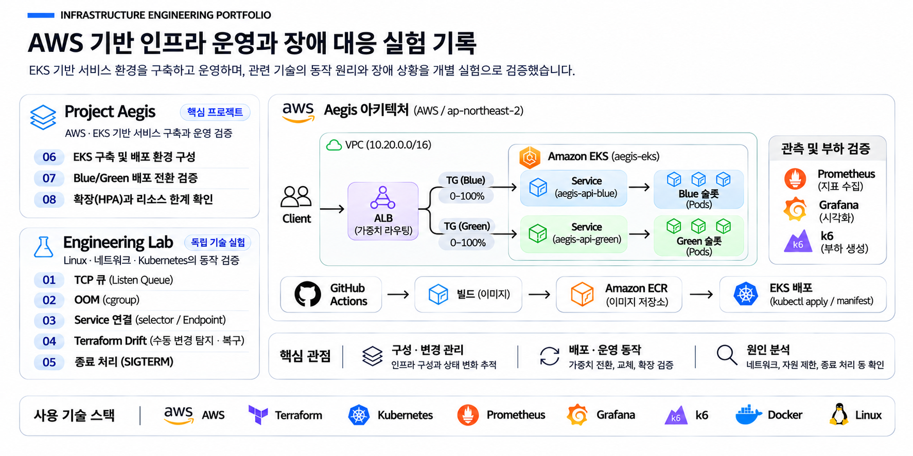

<!-- 메인 README: 전체 포트폴리오 소개 / 개별 실험 그래프와 증빙은 각 상세 문서에서 제공 -->

AWS에 서비스 환경을 직접 구축하고, 배포하거나 장애가 생겼을 때 시스템이 어떻게 움직이는지 확인했습니다. 예상과 다르게 나온 결과도 있었고, 단순히 성공이나 실패만 기록하기보다는 왜 그런 결과가 나왔는지 살펴보려고 했습니다.

기록은 두 갈래입니다. **Project Aegis**는 AWS에 환경을 구축하고 배포와 장애 상황을 확인한 프로젝트이고, **Engineering Lab**은 Linux·네트워크·Kubernetes의 동작을 작은 환경에서 따로 확인한 실험입니다.

---

## A. Project Aegis

AWS에 서비스 환경을 직접 구축하면서 권한과 비용, 가용성을 어떻게 정할지 고민했고, 구축한 환경에서 배포와 장애 상황의 동작을 확인했습니다. Blue/Green 실험은 같은 구성을 다시 만든 환경에서, CPU 제한·HPA·OOM은 별도의 EKS 측정 환경에서 진행했습니다.

### 권한이 없어 구축이 멈췄을 때

Terraform으로 VPC·EKS·IAM·ECR을 구성하다가 `ec2:DescribeAddressesAttribute` 권한이 없어 중간에 멈췄습니다. 이미 만들어진 리소스가 있어서 처음부터 다시 돌릴 수도 없었습니다. 그래서 실제 AWS 상태, Terraform State, 새 Plan을 차례로 맞춰 보고 나서 복구했습니다. NAT Gateway는 비용 때문에 하나만 뒀습니다. 대신 그 AZ에 장애가 나면 다른 AZ도 외부 통신이 끊깁니다. 권한도 오류를 보면서 나눴을 뿐, 최소 권한까지는 가지 못했습니다.

[EKS 구축·권한 문제 상세 기록](investigations/06-aws-eks-infrastructure/README.md)

### 정상이라고 나오는데 API는 실패했을 때

Blue에서 Green으로 트래픽을 넘긴 뒤 업무 API에 일부러 장애를 넣어 봤습니다. `/healthz`, `/readyz`, ALB Target Health는 모두 정상이었는데 외부 `/api/info` 요청은 **11번 모두 HTTP 503**이었습니다. 가중치를 Blue로 되돌리니 **21번 모두 HTTP 200**이었습니다. 두 슬롯은 같은 이미지였고, 전환과 복귀도 손으로 했습니다. 자동 배포나 롤백은 만들지 않았습니다.

[Blue/Green 배포·복구 상세 기록](investigations/07-safe-deployment/README.md)

### Pod 하나를 지웠을 때

API Pod 두 개 가운데 하나를 삭제하고 약 1초 간격으로 외부 요청을 보냈습니다. **순차 요청 90건은 모두 HTTP 200**이었고, 새 Pod가 처음 응답한 건 삭제 요청에서 약 **7초** 뒤였습니다. 다만 이건 제가 관측한 시간 차이이고, 실제 장애 복구시간을 측정한 건 아닙니다.

[Pod 교체 중 요청 흐름 상세 기록](investigations/06-aws-eks-infrastructure/README.md)

### 한도를 걸고 부하를 줬을 때

CPU 제한을 바꿔 가며 지연을 비교했고, HPA를 켰다 껐다 하며 확장 동작도 봤습니다. HPA는 **1→2→1 Pod**로 늘고 줄었지만 Pod 하나로도 30 RPS가 처리돼서, 응답이 빨라졌다고는 말할 수 없었습니다. 기대와 다른 결과였습니다. 메모리 한도는 독립 Job으로 비교했고, 128Mi에서는 OOMKilled, 256Mi에서는 정상 종료됐습니다.

[CPU·HPA·OOM 상세 기록](investigations/08-observability-scaling/README.md)

---

## B. Engineering Lab

Engineering Lab에서는 Linux·네트워크·Kubernetes의 동작을 작은 환경에서 따로 확인했습니다. 같은 접속 실패나 프로세스 종료라도 원인은 다를 수 있어, 요청 결과만 보지 않고 커널 기록과 Kubernetes 리소스 상태를 함께 살펴봤습니다.

### TCP 대기열과 연결 수락 지연

동시 요청 30개를 보내면서 `backlog`와 연결 수락 지연을 따로따로 바꿨습니다. 대기열을 늘리니 Listen Overflow 증가는 사라졌는데 HTTP 성공은 **8/30** 그대로였고, 인위적으로 넣은 수락 지연을 없애자 **30/30**이 응답했습니다.

[TCP Listen Queue 상세 기록](investigations/01-tcp-listen-queue/README.md)

### Linux 메모리 제한과 OOM

VM에는 여유 메모리가 남아 있었지만, 64MiB로 제한한 cgroup 안에서는 프로세스가 OOM으로 종료됐습니다. 커널의 `CONSTRAINT_MEMCG` 기록과 메모리 사용량을 함께 확인해 시스템 전체의 메모리 부족과 구분했습니다.

[Linux OOM·cgroup 상세 기록](investigations/02-linux-oom-cgroup/README.md)

### Kubernetes Service 연결

Service 이름은 정상적으로 IP로 해석됐는데 HTTP 연결은 실패했습니다. DNS 자체가 아니라 Service selector가 Pod 라벨과 맞지 않아 EndpointSlice에 연결 대상이 없었던 상황으로, selector 복구 후 HTTP 200까지 확인했습니다.

[Kubernetes Service 연결 상세 기록](investigations/03-kubernetes-dns/README.md)

### Terraform 설정 변경 감지

AWS 콘솔에서 보안 그룹 인바운드 규칙을 직접 바꿔 놓고 `terraform plan`이 무엇을 잡아내는지 봤습니다. 코드와 달라진 규칙은 plan에 잡혔고, 변경 범위를 확인한 뒤 수동으로 되돌렸습니다.

[Terraform Drift 상세 기록](investigations/04-terraform-drift/README.md)

### 종료 신호와 진행 중인 요청

로컬 kind에서 SIGTERM 직후 종료하는 방식과 처리 중인 요청을 마친 뒤 종료하는 방식을 비교했습니다. 별도의 Worker Drain 실험에서는 Pod 퇴거·재배치와 요청 응답을 관측했으며, 실제 Spot 인스턴스 중단을 발생시킨 실험은 아닙니다.

[SIGTERM·Worker Drain 상세 기록](investigations/05-graceful-shutdown/README.md)

---

실험 환경 · AWS 서울 리전 (`ap-northeast-2`), Linux VM, 로컬 kind. 실험별 설정·로그·그래프·재현 조건은 각 상세 README에 정리했습니다. GitHub Actions의 자동화 범위는 OIDC 기반 ECR 이미지 게시까지이며, EKS 배포와 복귀는 수동으로 수행했습니다.

폴더 안내 · `investigations/06`–`08`은 Project Aegis, `01`–`05`는 Engineering Lab입니다.
