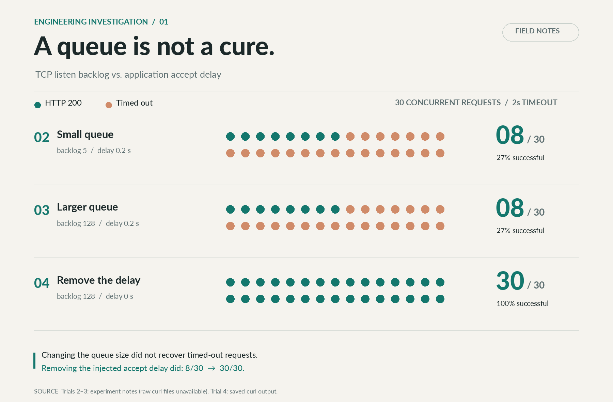

# 대기열을 늘렸는데도 HTTP 타임아웃은 그대로였다

<sub>TCP Listen Queue · Linux · Python socket<br>Ubuntu 24.04 / Multipass (ARM64) · 단일 스레드 Python 서버 · macOS `curl`</sub>

동시에 연결이 몰리는 상황에서 Listen 대기열을 넓히면 타임아웃도 줄어들 거라 예상했지만, `backlog`를 5에서 128로 늘린 뒤에도 HTTP 응답을 받지 못한 요청은 22개로 똑같았습니다. 큐 크기만의 문제는 아닌 것 같아서 `accept()` 호출 전 지연을 바꿔 가며 HTTP 결과와 커널 카운터를 같이 비교했습니다.

## 30개 요청을 세 가지 조건에서 비교

요청은 매번 30개를 동시에 보냈고, 클라이언트 타임아웃은 2초로 고정했습니다. 서버의 `accept-delay`는 `accept()` 호출 전에 의도적으로 기다리도록 만든 설정입니다.

| 조건 | `backlog` | `accept-delay` | HTTP 200 | HTTP 응답 없이 종료 | `ListenOverflows` 증가 |
|:--|--:|--:|--:|--:|--:|
| Trial 2 · 작은 큐와 수락 지연 | 5 | 0.2초 | 8 | 22 | +92 |
| Trial 3 · 큐만 확장 | 128 | 0.2초 | 8 | 22 | 0 |
| Trial 4 · 수락 지연 제거 | 128 | 0초 | 30 | 0 | 측정 연속성 미확보 |



카운터만 보면 좋아진 것 같았습니다. Overflow 증가량이 +92에서 0이 됐습니다. 그런데 curl 결과는 두 조건 모두 22개가 2초 안에 응답을 받지 못했습니다. 커널 신호는 달라졌는데 클라이언트가 겪은 결과는 같았습니다.

같은 `backlog=128`에서 수락 지연을 제거한 Trial 4는 30개 모두 HTTP 200이었고, 보관된 클라이언트 출력에서 가장 오래 걸린 요청도 약 21.9ms였습니다.

## `accept()` 전에 넣은 지연

실험용 서버는 연결을 하나씩 처리하고, `accept()`를 부르기 전에 잠시 멈추게 했습니다.

```python
while True:
    if args.accept_delay > 0:
        time.sleep(args.accept_delay)
    conn, addr = server.accept()
```

`--accept-delay 0.2`라면 매번 연결을 받아들이기 전에 0.2초를 기다립니다. 실제 서비스에서 겪은 장애가 아니라, 대기열 크기와 수락 속도의 영향을 나눠 보려고 만든 조건입니다.

`backlog`를 늘려도 `sleep()`은 그대로입니다. 큐가 아무리 넉넉해도 서버가 연결을 받는 속도는 같아서, 2초 제한을 넘긴 겁니다.

## HTTP 결과만으로는 보이지 않는 부분

서버에서는 `ss`로 Listen 소켓 상태를 확인했고, `/proc/net/netstat`의 `ListenOverflows`와 `ListenDrops`도 기록했습니다. `curl`은 제한 시간 안에 응답이 왔는지만 알려 주고, 커널 카운터는 큐가 찼을 때 올라갑니다. 보는 것이 달라서 같이 기록했습니다.

가령 Overflow가 92 증가했다고 해서 HTTP 요청 92건이 실패했다는 뜻은 아닙니다. 실제로 대기열을 넓힌 Trial 3에서는 Overflow 증가가 없었는데도 HTTP 응답을 받지 못한 요청이 22개였습니다.

Trial 3은 Overflow가 늘지 않았는데도 응답이 늦었습니다. 이때부터는 큐 크기보다 서버가 `accept()`를 언제 부르는지를 봐야 했습니다.

## 재현 환경과 실행 방법

서버는 Ubuntu VM에서, 동시 요청은 Mac에서 실행하는 구성입니다. 아래 명령어는 비교한 세 조건을 재현할 때 사용할 수 있습니다.

Ubuntu VM — 서버 실행:

```bash
python3 -u server.py --backlog 5 --accept-delay 0.2
# Trial 3: --backlog 128 --accept-delay 0.2
# Trial 4: --backlog 128 --accept-delay 0
```

Mac — 동시 요청 30개 (VM IP는 실행 환경에 맞게 변경):

```bash
seq 1 30 | xargs -P30 -I{} curl --max-time 2 -sS -o /dev/null \
  -w '{} HTTP %{http_code} %{time_total}s\n' http://192.168.252.2:8080/
```

요청 전후에는 VM에서 `scripts/check-state.sh`로 Listen 상태와 커널 카운터를 수집했습니다. 카운터는 누적값이므로 각 Trial의 전후 차이를 기준으로 비교했습니다.

## 남아 있는 기록과 한계

Trial 2·3의 HTTP 성공·실패 건수는 비교 기록에 남아 있지만, 클라이언트 원본 출력은 보관하지 못했습니다. 대신 커널 카운터 전후 파일은 남아 있습니다. Trial 4는 클라이언트 출력 원본이 있으나, 서버 종료 뒤 확인한 커널 카운터로는 해당 Trial의 Overflow 증가량을 확정할 수 없습니다.

이번 기록은 단일 스레드 서버에 보낸 동시 요청 30개를 세 조건에서 비교한 결과입니다. 반복 측정했는지는 남은 자료로 확인하지 못해서, 실제 서비스의 처리량이나 지연 개선으로 일반화하지는 않습니다. `backlog`를 늘릴 필요가 없다는 뜻도 아닙니다.

## 코드와 증빙

- [`server.py`](server.py) — `accept()` 앞에 지연을 넣은 HTTP 서버
- [`scripts/check-state.sh`](scripts/check-state.sh) — Listen 소켓 및 커널 카운터 조회
- [`evidence/comparison.csv`](evidence/comparison.csv) — Trial별 비교 데이터
- [`evidence/http-outcomes.png`](evidence/http-outcomes.png) — HTTP 결과 그래프
- `evidence/trial2/before.txt` · `after.txt` — 작은 큐에서의 커널 기록
- `evidence/trial3/before.txt` · `after.txt` — 큐 확장 후의 커널 기록
- `evidence/trial4/http-results.txt` — 수락 지연 제거 후 클라이언트 출력
- `evidence/trial4/before.txt` · `after.txt` — Trial 4 커널 기록 (측정 시점 주의)
- `evidence/baseline-listen-counters.txt` · `baseline-ss.txt` · `baseline-resources.txt` — 정상 상태 측정
