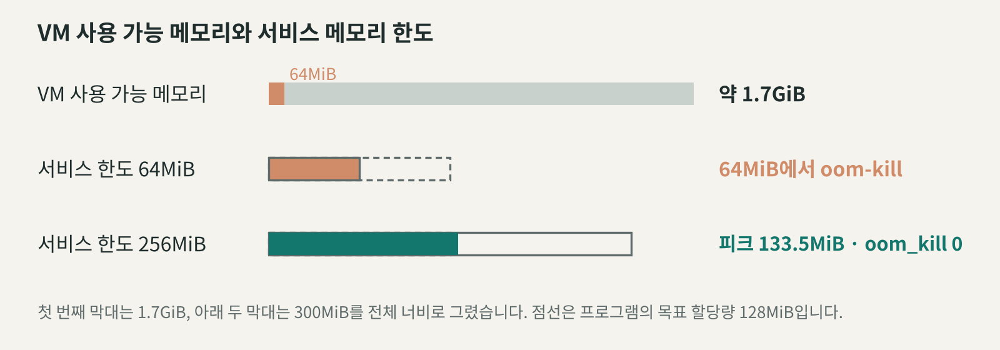

# 여유 메모리가 1.7GiB 남았는데도 프로세스는 OOM으로 종료됐다

<sub>Linux OOM Killer · cgroup v2 · systemd<br>Ubuntu 24.04 / Multipass · 2 vCPU · RAM 약 1.9GiB · Swap 없음</sub>

VM의 사용 가능 메모리는 약 1.7GiB였지만, 64MiB 제한을 건 서비스는 OOM으로 종료됐습니다. 시스템 전체의 메모리 부족과 특정 cgroup의 한도 초과가 어떻게 다른지, 종료 기록과 메모리 사용량을 나란히 놓고 확인했습니다.

## 64MiB 제한에서의 OOM

Python 프로그램이 메모리를 128MiB까지 조금씩 확보하도록 만들고, 이 프로그램을 systemd 서비스로 실행하면서 `MemoryMax=64M`을 걸었습니다. `MemoryMax`는 systemd가 서비스의 cgroup에 정하는 메모리 상한입니다.

할당 로그는 48MiB까지 출력됐고, 이후 서비스가 `oom-kill`로 끝났습니다. systemd가 보고한 메모리 피크는 64.0M이었습니다. 반면 VM은 정상적으로 응답했고, 사용 가능한 메모리도 여전히 약 1.7GiB였습니다. VM 전체가 부족했던 것이 아니라 이 서비스의 한도만 넘은 셈입니다.

실제 운영 장애가 아니라 한도를 일부러 넘기게 만든 재현 환경입니다.

## 원인 구분

systemd 로그에는 프로세스가 OOM Killer에게 종료됐다고 남아 있었습니다.

```text
A process of this unit has been killed by the OOM killer.
Main process exited, code=killed, status=9/KILL
Failed with result 'oom-kill'
```

다만 이것만으로는 시스템 전체의 OOM인지 구분되지 않아서 커널 기록도 봤습니다.

```text
oom-kill:constraint=CONSTRAINT_MEMCG,...,oom_memcg=/system.slice/oom-lab.service,...,task=python3,pid=27212
Memory cgroup out of memory: Killed process 27212 (python3)
```

`CONSTRAINT_MEMCG`는 시스템 전체가 아니라 메모리 cgroup의 제약 때문에 난 OOM이라는 표시입니다. 실험 전후의 `/proc/vmstat`에서도 `oom_kill`이 0에서 1로 바뀌었습니다. 숫자 하나로 단정하지 않으려고 종료 기록, 커널의 제약 정보, VM 상태를 함께 확인했습니다.

## 한도를 256MiB로 올렸을 때

프로그램과 목표 할당량(128MiB)은 그대로 두고 `MemoryMax`만 64MiB에서 256MiB로 바꿨습니다.

| 확인한 것 | 64MiB 제한 | 256MiB 제한 |
|---|---|---|
| 목표 할당량 | 128MiB | 128MiB |
| 프로그램 출력 | 48MiB까지 출력 후 종료 | 128MiB 할당 완료 |
| 종료 / 이벤트 | `oom-kill` | 검증 시 `oom_kill=0` |
| 관찰된 피크 | systemd 요약 `64.0M` | cgroup `memory.peak` 133.5MiB |



256MiB에서는 할당을 끝내고 메모리를 유지했습니다. 처음 실행은 4초 제한을 둔 테스트여서 `status=124`로 끝났는데, 이는 OOM이 아니라 `timeout`에 의한 종료입니다.

그 첫 실행의 systemd 요약에는 `Memory peak: 2.9M`이 찍혀 있었습니다. 128MiB를 확보했다는 출력과 맞지 않아서 사용량으로 쓰지 않고, 같은 256MiB 제한으로 서비스를 다시 띄워 cgroup 파일을 직접 읽었습니다.

```text
memory.current  139808768 bytes   (약 133.3MiB)
memory.peak     140034048 bytes   (약 133.5MiB)
memory.max      268435456 bytes   (256MiB)
memory.events   oom 0 / oom_kill 0
```

재측정으로 실행 중 실제 점유량이 약 133MiB라는 점은 확인했습니다. 다만 처음의 `2.9M`이 왜 나왔는지는 밝히지 못했고, 원인을 알 수 없는 값은 판단 근거로 쓰지 않았습니다.

## 재현 환경과 실행 방법

Ubuntu VM에서 `memory_hog.py`가 있는 디렉터리로 이동해 스크립트의 절대 경로를 준비합니다.

```bash
OOM_SCRIPT_PATH="$(pwd)/memory_hog.py"

# cgroup 한도 64MiB에서 OOM 재현
sudo systemd-run --unit=oom-lab --collect --wait --pipe -p MemoryMax=64M \
  /usr/bin/python3 -u "$OOM_SCRIPT_PATH" --mb 128 --step 16 --interval 0.2

# 제한 256MiB로 변경 후 동일 할당 시도
sudo systemd-run --unit=oom-lab-verify --collect -p MemoryMax=256M \
  /usr/bin/python3 -u "$OOM_SCRIPT_PATH" --mb 128 --step 16 --interval 0.2
```

`oom-lab-verify`는 측정을 마친 뒤 `sudo systemctl stop oom-lab-verify.service`로 종료했습니다.

## 남아 있는 기록과 한계

이번 기록은 단일 할당 패턴에서 확인한 결과입니다. 반복 측정이나 여러 프로세스가 함께 있을 때의 영향, 서비스 지연에 미치는 영향은 보지 않았습니다. 그래서 256MiB에서 이 작업이 끝났다고 해서 그 값이 운영 환경의 적정 제한이라고 말할 수는 없습니다. 48MiB, 64.0M과 최초 실행의 `timeout`·`status=124`·2.9M은 당시 실험 기록이며, 해당 터미널 출력 전체가 공개 증빙에 남아 있지는 않습니다.

OOM이 발생했다면 시스템 메모리 사용률만 보지 않고, 해당 프로세스의 cgroup 한도와 `memory.events`, 커널 종료 기록까지 함께 확인해야 합니다.

## 코드와 증빙

- [`memory_hog.py`](memory_hog.py) — 메모리를 단계적으로 할당하는 테스트 프로그램
- [`evidence/baseline.txt`](evidence/baseline.txt) — 실험 전 VM 메모리, Swap, OOM 카운터
- [`evidence/oom-journal.txt`](evidence/oom-journal.txt) — systemd 종료 기록
- [`evidence/oom-kernel.txt`](evidence/oom-kernel.txt) — `CONSTRAINT_MEMCG`, 종료된 PID
- [`evidence/after-oom.txt`](evidence/after-oom.txt) — OOM 후 VM 정상 응답과 카운터
- [`evidence/improved-memory.txt`](evidence/improved-memory.txt) — 256MiB 조건의 `memory.current`, `memory.peak`, `memory.events`
