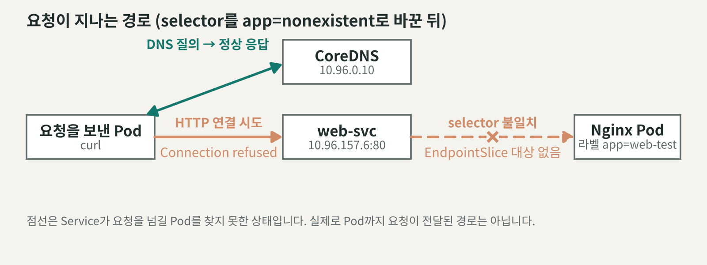

# Service 이름은 해석됐는데 HTTP 연결은 거부됐다

<sub>Kubernetes · CoreDNS · Service · EndpointSlice<br>kind-cka (Kubernetes v1.37.0) · `dns-lab` 네임스페이스 · Nginx 1.27</sub>

Service 이름은 IP로 해석됐는데, 같은 이름으로 보낸 HTTP 요청은 `Connection refused`로 끝났습니다. DNS 조회가 성공해도 접속은 안 될 수 있다는 걸 확인하려고, `dns-lab`에서 Service의 연결 대상을 일부러 잘못 설정했다가 되돌려 봤습니다. 실제 장애가 아니라 직접 주입한 오류입니다.

## 바꾼 것은 DNS가 아니라 Service selector였습니다

Nginx Pod의 라벨은 `app=web-test`였습니다. Service selector만 `app=nonexistent`로 바꿨고, DNS 설정과 Nginx Pod는 건드리지 않았습니다. 정상 상태에서는 Service 이름으로 요청해 [Nginx의 HTTP 200](evidence/http-baseline.txt)을 받았고, selector를 바꾼 뒤에는 같은 이름이 `10.96.157.6`으로 해석되는데도 [HTTP 연결이 거부](evidence/http-connection-refused.txt)됐습니다(curl 종료 코드 7). selector를 `app=web-test`로 되돌리자 [HTTP 200](evidence/http-recovery.txt)이 다시 나왔습니다.



| 확인 지점 | 정상 | selector 오류 주입 | 복구 |
|:--|:--|:--|:--|
| Service selector | `app=web-test` | `app=nonexistent` | `app=web-test` |
| EndpointSlice | Nginx Pod 연결 | 등록된 대상 없음 (`<unset>`) | `10.244.0.8:80` |
| 이름 해석 | Service 이름으로 요청 | `10.96.157.6` 확인 | Service 이름으로 요청 |
| HTTP 요청 | `200 OK` | `Connection refused` | `200 OK` |

정상과 복구 단계의 증빙에는 이름 해석 기록이 따로 없고, Service 이름으로 보낸 HTTP 요청이 성공했다는 결과만 있습니다. 오류 주입 단계에서는 curl 출력에 `web-svc.dns-lab.svc.cluster.local`이 `10.96.157.6`으로 해석됐다고 나옵니다.

## 다음에 같은 증상을 만나면

접속 실패를 곧바로 DNS 문제라고 단정하지 않고, 이름이 IP로 해석되는지 본 다음 Service selector와 Pod label, EndpointSlice에 실제 주소가 등록돼 있는지 확인할 생각입니다. 다만 이번에 본 `Connection refused`가 Endpoint 오류에서 늘 같은 방식으로 나타난다는 뜻은 아닙니다. 클러스터의 네트워크 구현이나 장애 조건에 따라 다르게 나타날 수 있습니다.

## 조사 과정과 재현

<details>
<summary>정상 응답부터 selector 오류와 복구까지 · 설정과 로그</summary>

먼저 정상 경로를 확인했습니다. CoreDNS Deployment는 `2/2 Ready`였고, 테스트 Pod에서 Kubernetes 기본 서비스 주소를 조회하자 DNS 서버 `10.96.0.10`이 `kubernetes.default.svc.cluster.local`을 `10.96.0.1`로 해석했습니다. 이어 `web-test` Deployment(Nginx)와 `web-svc` Service를 만들고 Service 이름으로 요청하자 정상 응답이 왔습니다.

```text
HTTP/1.1 200 OK
Server: nginx/1.27.5
```

그다음 `web-svc`의 selector를 존재하지 않는 `app=nonexistent`로 바꿨습니다.

```bash
kubectl patch service web-svc -n dns-lab \
  -p '{"spec":{"selector":{"app":"nonexistent"}}}'
```

EndpointSlice에서는 연결할 Pod가 사라졌습니다.

```text
NAME            ADDRESSTYPE   PORTS     ENDPOINTS
web-svc-4kmtm   IPv4          <unset>   <unset>
```

그런데 같은 Service 주소의 DNS 조회는 여전히 정상이었습니다.

```text
Name:    web-svc.dns-lab.svc.cluster.local
Address: 10.96.157.6
```

HTTP 요청만 거부됐습니다. 이름은 계속 해석되고 있었고, 문제는 Service가 요청을 넘길 Endpoint가 없다는 쪽이었습니다.

```text
* Host web-svc.dns-lab.svc.cluster.local:80 was resolved.
* IPv4: 10.96.157.6
* Trying 10.96.157.6:80...
* connect to 10.96.157.6 port 80 ... failed: Connection refused
curl: (7) Failed to connect
```

selector를 `app=web-test`로 되돌리자 EndpointSlice에 Nginx Pod IP가 다시 나타났고, 같은 Service 이름으로 `HTTP 200`이 돌아왔습니다.

```text
NAME            ADDRESSTYPE   PORTS   ENDPOINTS
web-svc-4kmtm   IPv4          80      10.244.0.8
```

</details>

<details>
<summary>DNS Timeout과 NXDOMAIN은 어떻게 달랐나</summary>

DNS 서버 주소를 일부러 `192.0.2.53`(문서·시험용 예약 주소)으로 지정했을 때는 응답이 없었고, 정상 CoreDNS에 존재하지 않는 서비스 이름을 물었을 때는 이름이 없다는 응답이 왔습니다.

```text
;; connection timed out; no servers could be reached
```

```text
Server: 10.96.0.10
** server can't find nonexistent-service.dns-lab.svc.cluster.local: NXDOMAIN
```

Timeout은 지정한 DNS 서버에서 응답이 오지 않은 경우이고, NXDOMAIN은 DNS 서버가 그 이름이 없다고 답한 경우입니다. 이 차이로 원인을 다 알 수는 없지만 처음 볼 곳이 달라집니다. Kubernetes의 DNS 장애를 발견한 게 아니라, 실패 유형의 차이를 보려고 조건을 일부러 바꾼 테스트입니다.

</details>

<details>
<summary>재현 명령과 증빙 파일 · 보존 범위</summary>

`web-test`/`web-svc`가 없는 새 환경을 기준으로 핵심 흐름만 추렸습니다. 일회성 curl Pod의 결과는 `kubectl logs`로 확인했고, 실제 실험의 Pod 이름과는 일부 다릅니다.

```bash
kubectl create namespace dns-lab
kubectl create deployment web-test --image=nginx:1.27 -n dns-lab
kubectl expose deployment web-test -n dns-lab --name=web-svc --port=80 --target-port=80

# 장애 주입 → Endpoint 확인 → 복구
kubectl patch service web-svc -n dns-lab -p '{"spec":{"selector":{"app":"nonexistent"}}}'
kubectl get endpointslices -n dns-lab -l kubernetes.io/service-name=web-svc
kubectl patch service web-svc -n dns-lab -p '{"spec":{"selector":{"app":"web-test"}}}'

# 복구 확인: Endpoint가 다시 생겼는지, 같은 이름으로 HTTP 200이 오는지
kubectl get endpointslices -n dns-lab -l kubernetes.io/service-name=web-svc
kubectl run http-after -n dns-lab --image=curlimages/curl:8.11.1 --restart=Never -- \
  curl -sS -o /dev/null -w 'HTTP %{http_code}\n' --max-time 5 http://web-svc.dns-lab.svc.cluster.local
kubectl logs http-after -n dns-lab
```

- [`evidence/dns-baseline.txt`](evidence/dns-baseline.txt) — 기본 Kubernetes Service의 정상 DNS 조회
- [`evidence/dns-timeout.txt`](evidence/dns-timeout.txt) · [`evidence/dns-nxdomain.txt`](evidence/dns-nxdomain.txt) — Timeout과 NXDOMAIN
- [`evidence/http-baseline.txt`](evidence/http-baseline.txt) · [`evidence/http-connection-refused.txt`](evidence/http-connection-refused.txt) · [`evidence/http-recovery.txt`](evidence/http-recovery.txt) — 정상, 연결 거부, 복구 후의 HTTP 결과
- [`evidence/workload-config.yaml`](evidence/workload-config.yaml) — 복구 후 Deployment·Service 설정 스냅샷
- [`evidence/service-selector-path.png`](evidence/service-selector-path.png) — 위 경로 도식

EndpointSlice의 장애 전후 출력과 `web-svc`의 `Name`/`Address` 조회 출력은 당시 터미널에서 확인했지만 별도 원본 파일로 저장하지 못했습니다. `workload-config.yaml`은 복구 후 설정만 담고 있어서 장애 당시의 selector 상태를 증명하는 자료로는 쓰지 않습니다.

</details>
