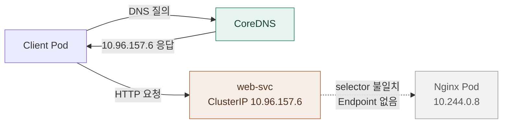

# DNS는 정상이었는데, 왜 서비스에 접속하지 못했을까?

**Kubernetes · CoreDNS · Service · EndpointSlice**  
실험 환경: `kind-cka` (Kubernetes v1.37.0) / `dns-lab` 네임스페이스 / Nginx 1.27

Pod에서 서비스에 접속하지 못할 때 DNS부터 의심하기 쉽다. 그런데 이름이 IP로 정상 변환되더라도, 그 뒤에서 실제 요청을 받아 줄 Pod가 없다면 연결은 실패할 수 있다. 이번에는 DNS 응답이 서로 어떻게 다른지 확인한 뒤, Service의 연결 대상을 의도적으로 잘못 설정해 **DNS 조회 성공과 HTTP 통신 성공이 별개라는 점**을 확인했다.

실제 운영 장애를 해결한 기록은 아니다. CoreDNS나 다른 실습 리소스에 영향을 주지 않도록 `dns-lab` 안에서 장애를 직접 만들고 원래 상태로 복구한 실험이다.

## 먼저, 정상 경로를 확인했다

CoreDNS Deployment는 `2/2 Ready`였고, 테스트 Pod에서 Kubernetes 기본 서비스 주소를 조회하자 DNS 서버 `10.96.0.10`이 `kubernetes.default.svc.cluster.local`을 `10.96.0.1`로 해석했다.

이후 `web-test` Deployment(Nginx)와 `web-svc` Service를 만들었다. Service 이름으로 HTTP 요청을 보냈을 때는 다음과 같이 응답했다.

```text
HTTP/1.1 200 OK
Server: nginx/1.27.5
```

이 결과를 정상 기준으로 남겼다. 조회가 성공했다는 사실뿐 아니라, 서비스 이름을 통해 실제 HTTP 응답까지 받았다는 점이 중요했다.

## 비슷해 보이지만 서로 다른 DNS 실패

먼저 DNS 서버 주소를 의도적으로 `192.0.2.53`(문서·시험용 예약 주소)으로 지정했다. 이 경우에는 다음처럼 응답을 받지 못했다.

```text
;; connection timed out; no servers could be reached
```

반면 정상 CoreDNS를 사용하면서 존재하지 않는 서비스 이름을 조회했을 때는 결과가 달랐다.

```text
Server: 10.96.0.10
** server can't find nonexistent-service.dns-lab.svc.cluster.local: NXDOMAIN
```

두 경우 모두 원하는 이름을 IP로 얻지 못했지만, **Timeout은 지정한 DNS 서버에서 응답이 오지 않은 경우**, **NXDOMAIN은 DNS 서버가 이름이 존재하지 않는다고 응답한 경우**다. 이 차이만으로 문제 원인을 모두 알 수는 없지만, 처음 확인할 대상을 달리하는 데 도움이 된다.

> 이 두 테스트는 Kubernetes의 DNS 장애를 직접 발견한 것이 아니다. 실패 유형의 차이를 관찰하기 위해 조건을 의도적으로 바꿨다.

## DNS는 성공했는데 HTTP는 거부됐다

### 어디서 연결이 끊겼는지

DNS 조회와 HTTP 요청은 같은 작업이 아니다. 이번에는 이름 해석 경로는 유지됐지만, Service 뒤에서 트래픽을 받을 Endpoint가 사라졌다.



*점선은 실제 통신이 아니라 연결이 끊어진 구간을 표시한다. 위 IP는 이번 실험에서 관찰한 값이다.*

핵심 실험에서는 DNS 설정이나 Nginx Pod를 건드리지 않았다. 대신 `web-svc`의 selector를 실제 Pod 라벨인 `app=web-test`에서 **존재하지 않는 `app=nonexistent`**로 바꿨다.

```bash
kubectl patch service web-svc -n dns-lab \
  -p '{"spec":{"selector":{"app":"nonexistent"}}}'
```

변경 직후 EndpointSlice를 조회하자 연결할 Pod가 사라진 상태였다.

```text
NAME            ADDRESSTYPE   PORTS     ENDPOINTS
web-svc-4kmtm   IPv4          <unset>   <unset>
```

그런데 같은 Service 주소를 DNS로 조회하면 여전히 정상 응답이 돌아왔다.

```text
Name:    web-svc.dns-lab.svc.cluster.local
Address: 10.96.157.6
```

실제 HTTP 요청은 달랐다.

```text
* Host web-svc.dns-lab.svc.cluster.local:80 was resolved.
* IPv4: 10.96.157.6
* Trying 10.96.157.6:80...
* connect to 10.96.157.6 port 80 ... failed: Connection refused
curl: (7) Failed to connect
```

여기서 진단의 방향이 분명해졌다. **서비스 이름은 해석되고 있었다.** 문제는 이름을 찾는 단계가 아니라, 그 Service가 요청을 넘겨줄 Endpoint를 갖고 있지 않다는 점이었다. 단순히 `nslookup`이 성공했다고 서비스가 정상이라고 판단하면 놓칠 수 있는 지점이다.

## selector를 되돌리자 연결이 복구됐다

`web-svc`의 selector를 다시 `app=web-test`로 변경했다.

```bash
kubectl patch service web-svc -n dns-lab \
  -p '{"spec":{"selector":{"app":"web-test"}}}'
```

복구 뒤 EndpointSlice에는 Nginx Pod IP가 다시 표시됐다.

```text
NAME            ADDRESSTYPE   PORTS   ENDPOINTS
web-svc-4kmtm   IPv4          80      10.244.0.8
```

같은 Service 이름으로 요청한 결과도 다시 `HTTP 200`이었다. **설정 수정 → Endpoint 복원 → 실제 HTTP 정상화**까지 확인한 셈이다.

### 장애 전후에 실제로 달라진 것

| 확인 지점 | 정상 | selector 오류 주입 | 복구 |
|:--|:--|:--|:--|
| Service DNS | 정상 | `10.96.157.6` 반환 | 정상 연결 결과 확인 |
| Service selector | `app=web-test` | `app=nonexistent` | `app=web-test` |
| EndpointSlice | Nginx 연결 상태 | 대상 없음 (`<unset>`) | `10.244.0.8:80` |
| HTTP 요청 | `200 OK` | `Connection refused` | `200 OK` |

DNS가 계속 동작한다는 사실과, Service가 실제 백엔드를 찾는지는 따로 확인해야 한다.

## 다음에 같은 증상을 보면

서비스 접속 실패를 곧바로 DNS 문제라고 단정하지 않겠다. 우선 이름이 IP로 해석되는지 살피고, 그다음 Service selector와 Pod label, EndpointSlice에 실제 주소가 등록돼 있는지 확인할 것이다. DNS 조회가 성공해도 연결 대상이 없을 수 있기 때문이다.

이번에 관찰한 `Connection refused`가 모든 Endpoint 오류의 공통 증상이라는 뜻은 아니다. 클러스터의 네트워크 구현이나 장애 조건에 따라 다른 형태로 나타날 수 있다. 또한 이번 실험은 selector 오류를 직접 주입했으므로, 실제 장애에서 원인을 처음부터 모르는 상황과는 구분해야 한다.

## 실험 재현과 기록

실험용 리소스는 `dns-lab` 네임스페이스에 생성했다. 아래는 핵심 재현 흐름만 추린 것이다. `web-test`/`web-svc`가 없는 새 실험 환경을 기준으로 한다.

```bash
kubectl create namespace dns-lab
kubectl create deployment web-test --image=nginx:1.27 -n dns-lab
kubectl rollout status deployment/web-test -n dns-lab
kubectl expose deployment web-test -n dns-lab --name=web-svc --port=80 --target-port=80

# 정상 상태 확인
kubectl get endpointslices -n dns-lab -l kubernetes.io/service-name=web-svc
kubectl run http-before -n dns-lab --image=curlimages/curl:8.11.1 --restart=Never -- \
  curl -sS -o /dev/null -w 'HTTP %{http_code}\n' --max-time 5 http://web-svc.dns-lab.svc.cluster.local
kubectl logs http-before -n dns-lab

# selector 장애 주입 후 Endpoint 확인
kubectl patch service web-svc -n dns-lab -p '{"spec":{"selector":{"app":"nonexistent"}}}'
kubectl get endpointslices -n dns-lab -l kubernetes.io/service-name=web-svc

# 복구
kubectl patch service web-svc -n dns-lab -p '{"spec":{"selector":{"app":"web-test"}}}'
kubectl get endpointslices -n dns-lab -l kubernetes.io/service-name=web-svc
```

`kubectl run`으로 만든 일회성 Pod의 결과는 `kubectl logs`에서 확인한다. 예시는 재현 흐름이며, 실제 실험에서 사용한 Pod 이름과는 일부 다르다.

**증거 파일**

| 파일 | 남긴 결과 |
|---|---|
| [`evidence/dns-baseline.txt`](evidence/dns-baseline.txt) | 기본 Kubernetes Service의 정상 DNS 조회 |
| [`evidence/dns-timeout.txt`](evidence/dns-timeout.txt) | 응답하지 않는 DNS 서버 지정 시 Timeout |
| [`evidence/dns-nxdomain.txt`](evidence/dns-nxdomain.txt) | 존재하지 않는 서비스 이름의 NXDOMAIN |
| [`evidence/http-baseline.txt`](evidence/http-baseline.txt) | 장애 전 Nginx HTTP 200 |
| [`evidence/http-connection-refused.txt`](evidence/http-connection-refused.txt) | 이름 해석 성공 후 연결 거부 |
| [`evidence/http-recovery.txt`](evidence/http-recovery.txt) | selector 복구 후 HTTP 200 |
| [`evidence/workload-config.yaml`](evidence/workload-config.yaml) | 복구 후 Deployment·Service 설정 스냅샷 |

EndpointSlice의 장애 전후 출력은 당시 터미널에서 확인했지만 별도 원본 파일로 저장하지 못했다. 위 `workload-config.yaml`은 복구 **후** 설정만 담고 있으며, 장애 당시의 selector 상태를 증명하는 파일로 사용하지 않는다.
