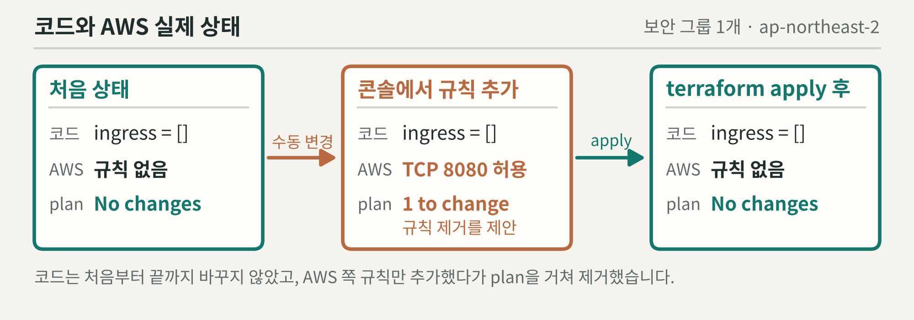
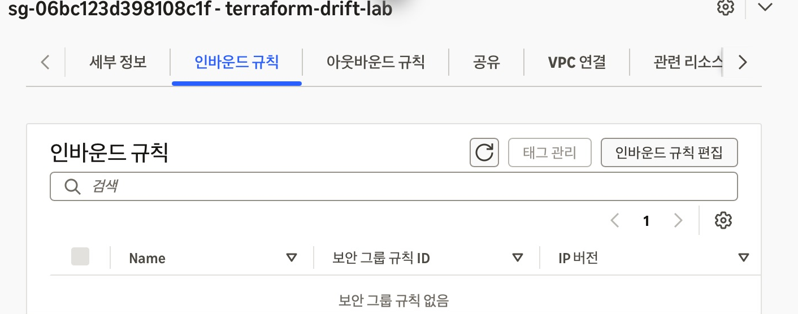
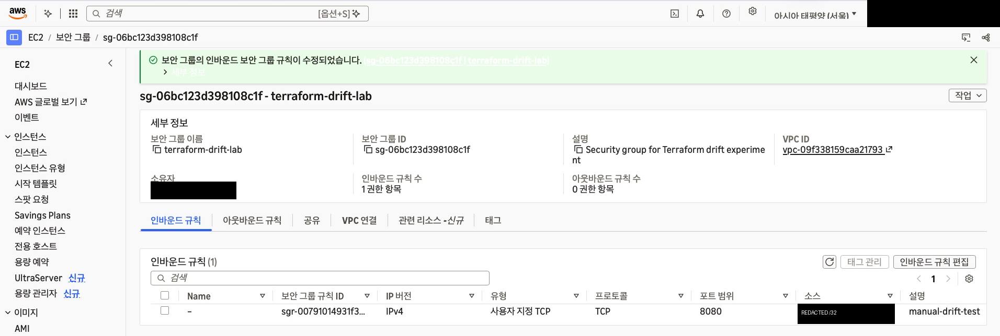

# 콘솔에서 추가한 규칙이 plan에 나타났다

<sub>Terraform · AWS Security Group · Configuration Drift · 서울 리전(`ap-northeast-2`)</sub>

Terraform으로 만든 보안 그룹에 AWS 콘솔에서 인바운드 규칙을 직접 추가했습니다. 코드는 건드리지 않았습니다. 이런 변경이 다음 `terraform plan`에 어떻게 나타나는지, 복구하면 어디까지 바뀌는지를 확인했습니다.

## 코드엔 없고 AWS에만 있는 규칙

보안 그룹은 인바운드 규칙이 없는 상태(`ingress = []`)로 만들었고, 이때의 `terraform plan`은 [변경 사항이 없다고 나왔습니다](evidence/01-baseline/baseline-plan.txt).



이 상태에서 코드는 그대로 두고 콘솔에서 TCP 8080 인바운드 규칙을 하나 추가했습니다. 허용 범위는 IPv4 주소 하나(`/32`)로 좁혔고, 설명에는 `manual-drift-test`를 적었습니다.

변경 전 콘솔에는 인바운드 규칙이 없습니다.



변경 후에는 TCP 8080 규칙이 한 줄 생겼습니다. 원본 화면은 [`sg-after-drift.png`](evidence/02-drift/sg-after-drift.png)입니다.



## plan이 제안한 변경

이 상태에서 `terraform plan`을 실행했습니다.

```text
Plan: 0 to add, 1 to change, 0 to destroy.
```

보안 그룹을 지우고 새로 만드는 계획이 아니라, 추가된 규칙만 제거하는 [`update in-place`](evidence/02-drift/drift-plan.txt)였습니다.

```diff
~ ingress = [
  - {
      - description = "manual-drift-test"
      - from_port   = 8080
      - to_port     = 8080
      - protocol    = "tcp"
    }
]
```

같은 규칙이 [AWS API 조회 결과](evidence/02-drift/aws-rules-after.json)에도 있었습니다. plan이 가리킨 규칙과 AWS에 실제로 있는 규칙이 같았으니, 코드 밖에서 생긴 변경을 Terraform이 찾아낸 것은 맞습니다.

다만 이 단계의 plan은 무엇을 할지 보여 줄 뿐, AWS 설정을 바꾸지는 않습니다. 찾아낸 것과 되돌린 것은 다른 단계입니다.

## 바로 되돌려도 될까

이번 규칙은 제가 실험하려고 직접 추가한 것이라 지워도 문제가 없었지만, 운영 환경이라면 이야기가 다릅니다. 운영 환경에서 발견한 변경이라면 먼저 변경 의도와 영향 범위를 확인해야 하고, 이번처럼 직접 만든 규칙에 내린 판단을 그대로 적용할 수는 없습니다.

## 복구와 재확인

여기서는 유지할 이유가 없는 규칙이라 되돌리기로 했습니다. 먼저 [plan을 다시 확인](evidence/04-recovery/recovery-plan.txt)했고, 앞서와 같이 TCP 8080 규칙 하나를 제거하는 내용이었습니다. 그다음 `terraform apply`를 실행했습니다.

```text
aws_security_group.drift_lab: Modifying...
aws_security_group.drift_lab: Modifications complete after 1s

Apply complete! Resources: 0 added, 1 changed, 0 destroyed.
```

보안 그룹을 새로 만드는 대신, 기존 보안 그룹의 인바운드 규칙을 수정했습니다. 처음 plan부터 [최종 plan](evidence/05-validation/final-plan.txt)까지 출력된 보안 그룹 ID(`sg-06bc…`)도 같았습니다. 이어서 AWS API로 규칙을 다시 조회했더니, [TCP 8080 규칙은 없어졌습니다](evidence/04-recovery/aws-rules-after-recovery.json).

```json
{
  "SecurityGroupRules": []
}
```

마지막으로 `terraform plan`을 한 번 더 실행했고, [처음과 같은 결과](evidence/05-validation/final-plan.txt)가 나왔습니다.

```text
No changes. Your infrastructure matches the configuration.
```

## 남은 한계

Terraform은 코드와 실제 인프라의 차이를 감지하고, 이를 해소할 변경 계획을 제시할 수 있습니다. 하지만 누가 왜 변경했는지까지는 알려 주지 않습니다. 실제 복구는 제가 `terraform apply`를 실행해서 이루어진 것입니다. 개발 환경에서는 허용 범위 안의 변경을 자동으로 복구하는 방식을, 운영 환경에서는 검토와 승인 뒤에 적용하는 방식을 생각해 볼 수 있습니다. 다만 둘 다 이번에는 해 보지 않았고, 확인한 범위는 수동 변경 탐지, 복구, 복구 후 재확인까지입니다.

보안 그룹은 EC2 인스턴스에 연결하지 않아서 서비스 영향은 측정하지 않았습니다.

## 증빙

공개용 plan 출력과 AWS 규칙 JSON에서는 계정 ID와 접속 IP를 가리거나 `EXPERIMENT_CLIENT_IP` 같은 값으로 바꿨고, 콘솔 스크린샷도 일부 가렸습니다. 규칙이 생기고 사라지는 내용은 그대로 두었습니다.

| 경로 | 기록 내용 |
|---|---|
| [`evidence/01-baseline/`](evidence/01-baseline/) | 변경 전 콘솔 화면과 [plan 결과](evidence/01-baseline/baseline-plan.txt) |
| [`evidence/02-drift/`](evidence/02-drift/) | 변경 후 콘솔 화면, [AWS 규칙 조회](evidence/02-drift/aws-rules-after.json), [drift plan](evidence/02-drift/drift-plan.txt) |
| [`evidence/04-recovery/`](evidence/04-recovery/) | [복구 plan](evidence/04-recovery/recovery-plan.txt), [복구 후 AWS 규칙 조회](evidence/04-recovery/aws-rules-after-recovery.json) |
| [`evidence/05-validation/`](evidence/05-validation/) | [최종 plan](evidence/05-validation/final-plan.txt) |

<details>
<summary>재현하려면</summary>

별도 VPC를 지정하지 않은 구성이라 해당 리전의 기본 VPC와 유효한 AWS 인증 설정(실험에서는 `terraform-lab` 프로필)이 필요합니다. 코드는 [`main.tf`](main.tf)입니다.

```bash
terraform init
terraform apply        # ingress = [] 로 생성
terraform plan         # No changes
# 콘솔에서 TCP 8080 인바운드 규칙 추가
terraform plan         # 1 to change (update in-place)
terraform apply        # 규칙 제거
terraform plan         # No changes
```

</details>
