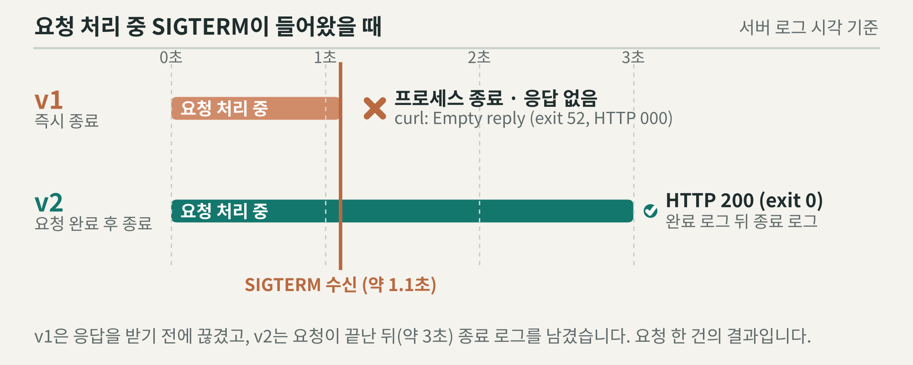

# SIGTERM에 끊기던 요청이 종료 처리 후 완료됐다

Kubernetes · Graceful Shutdown · kind(Control Plane 1, Worker 2) · Python ThreadingHTTPServer

처리 중인 요청에 SIGTERM을 보내자 기존 서버는 응답을 마치지 못하고 종료됐습니다. 종료 신호를 받은 뒤 진행 중인 요청을 기다리도록 바꾸자, 같은 방식으로 진행한 테스트에서는 HTTP 200이 돌아왔습니다.

이후 로컬 kind 클러스터에서 Worker Drain 중 순차 요청 20건을 확인했습니다. 두 실험은 요청 경로와 조건이 다르며, 실제 AWS Spot 중단을 재현한 것은 아닙니다.

## 컨테이너에 직접 보낸 SIGTERM, v1과 v2

이 비교는 Kubernetes 없이 Docker 컨테이너에 직접 요청을 보내서 했습니다. 테스트 서버는 요청마다 3초씩 기다리게 만들어서, 요청이 처리되는 중간에 종료 신호가 들어가도록 했습니다.

| | v1 (SIGTERM에 즉시 종료) | v2 (요청 완료 후 종료) |
|---|---|---|
| curl HTTP 코드 | 000 | 200 |
| curl 종료 코드 | 52 (`Empty reply from server`) | 0 |
| 서버 로그 | 요청 시작, SIGTERM 수신. 완료 기록 없음 | 요청 완료, 그 뒤 `graceful shutdown completed` |

v1은 요청을 처리하던 중에 프로세스가 끝나 버려서, curl이 `Empty reply from server`를 받았습니다. HTTP 000은 서버가 준 상태 코드가 아니라 응답을 받지 못했다는 표시입니다.

v2는 SIGTERM을 받으면 새 요청을 더 받지 않고, 처리 중인 요청을 최대 10초까지 기다린 뒤 종료합니다. 이번 요청 한 건에서는 HTTP 200이 돌아왔고, 서버 로그에도 요청 완료가 종료 완료보다 먼저 남았습니다.

## Worker Drain 중 순차 요청 20건

다음은 노드를 비우는 상황입니다. 서버 Pod 2개를 Service 뒤에 두고, Drain 대상이 아닌 `spot-lab-worker2`의 클라이언트 Pod에서 순차 요청을 보냈습니다. 요청을 시작하고 약 5초 뒤에 `spot-lab-worker`를 Drain했습니다.

| 측정 조건 | 전체 요청 | HTTP 200 | 관측된 실패 |
|---|---:|---:|---:|
| 정상 상태 | 20 | 20 | 0 |
| Worker Drain 중 | 20 | 20 | 0 |

Drain 로그에는 `spot-lab-worker`의 서버 Pod가 퇴거된 기록이 있고, 이후 Pod 목록에는 `spot-lab-worker2`에서 도는 Pod 2개가 남아 있습니다. 두 측정 모두 응답 시간은 약 3초였습니다.

실패가 없었다고 해서 Graceful Shutdown 덕분이라고 단정할 수는 없습니다. 요청을 순차로 보냈고, 다른 Worker에서 이미 돌고 있던 서버 Pod가 요청을 받을 수 있었기 때문입니다. Pod 상태는 Drain이 끝난 뒤에 확인해서 재배치에 걸린 시간도 재지 못했습니다. 이번 결과는 이 조건에서 HTTP 실패가 관측되지 않았다는 데까지입니다.

## 남은 한계

운영 환경에서 무중단을 말하려면 아직 확인하지 못한 것이 남아 있습니다.

- 종료되는 Pod로 요청이 계속 들어오는 구간입니다. Readiness Probe와 `preStop` Hook은 만들지 않았고, Pod가 트래픽 대상에서 빠지는 시점과 실제 요청이 들어오는 시점 사이의 경합도 재지 않았습니다. ([Pod 종료 절차](https://kubernetes.io/docs/concepts/workloads/pods/pod-termination/) 참고)
- v2의 503 응답 분기는 코드에만 있고, 실제로 503이 나가는지는 보지 못했습니다. 대기가 끝났는지 검사하는 코드도 없어서, 종료 완료 로그만으로 모든 요청이 끝났다고 말할 수는 없습니다. 동시 요청도 시험하지 않았습니다.
- 종료 유예시간은 30초, 앱의 최대 대기는 10초로 두었는데 이것이 종료 시간을 엄격히 보장하지는 않습니다. Pod 분산은 `DoNotSchedule`에서 RollingUpdate 중 Pending이 생겨 `ScheduleAnyway`로 바꿨습니다. 당시 Pending 출력은 없어서 원인은 확정하지 못했고, 이 설정이 Worker마다 하나씩 배치하는 것을 보장하지도 않습니다. ([저장된 Deployment](evidence/deployment-v2.yaml))
- `kubectl drain`은 계획된 퇴거를 관찰한 것입니다. Spot 중단 알림, 노드 종료까지의 제한 시간, 자동 Drain은 포함하지 않았습니다.

이번 실험은 kind 환경의 종료 처리와 Worker Drain에 한정됩니다. 실제 Spot 중단 처리와 Kubernetes의 트래픽 제외·종료 절차를 잇는 AWS/EKS 검증은 후속 과제로 남겼습니다.

## 증빙

- v1 결과: [클라이언트](evidence/http-sigterm.txt) · [서버 로그](evidence/http-sigterm-server.txt)
- v2 결과: [클라이언트](evidence/http-graceful.txt) · [서버 로그](evidence/http-graceful-server.txt)
- 순차 요청 20건: [정상 상태](evidence/http-drain-v2.txt) · [Drain 중](evidence/http-during-drain-v2.txt)
- Drain 기록: [실행 로그](evidence/drain-v2.txt) · [Drain 후 Pod 상태](evidence/pods-after-drain-v2.txt) · [초기 Drain 전](evidence/pods-before-drain.txt) · [초기 Drain 후](evidence/pods-after-drain.txt)
- 설정: [Deployment 조회 기록](evidence/deployment-v2.yaml)

재현 명령은 [REPRODUCE.md](REPRODUCE.md)에 따로 두었습니다.

실험 환경과 기록에 없는 것

### 실험 환경

- 로컬 Kubernetes: kind 기반 클러스터, Control Plane 1개와 Worker 2개
- 애플리케이션: Python ThreadingHTTPServer, 포트 8080, 요청 처리 시간 약 3초
- Deployment: replicas 2개, Service는 ClusterIP, 종료 유예시간 30초
- Pod 분산 정책: topologySpreadConstraints / ScheduleAnyway

기존 환경 메모에는 `v1.37.0`이 있지만 도구·클러스터 버전을 확인할 원본 출력은 보관하지 않았습니다. kind 버전과 Kubernetes 버전은 구분해서 적어야 하므로 확정하지 않았습니다.

### 기록에 없는 것

- 클라이언트 Pod 설정은 저장하지 않았습니다. 실험 당시 클라이언트는 `spot-lab-worker2`에 두었고, [재현 명령](REPRODUCE.md)에는 이를 명시했습니다.
- Drain을 요청 시작 약 5초 뒤에 실행했다는 순서는 당시 실행 기록이며, 로그에 공통 타임스탬프가 없습니다.
- v2 실험의 Drain 직전 Pod 목록은 보관하지 않았습니다. 초기 Drain 전후 목록은 ReplicaSet 해시가 `79b4b8cdb4`이고 v2 Drain 로그는 `644dfc7c8`이라서, 초기 목록을 v2 실험 직전 상태로 해석하지 않았습니다. v2 로그에서 퇴거된 `r759l` Pod는 이후 목록에 없고, `spot-lab-worker2`에 `mrh4s`와 기존 `w6mlk` Pod가 실행 중입니다.
- 단일 SIGTERM 실험에서 클라이언트가 잰 약 4.01초와 서버 로그의 요청 처리 시간 약 3초는 측정 지점이 다릅니다.

