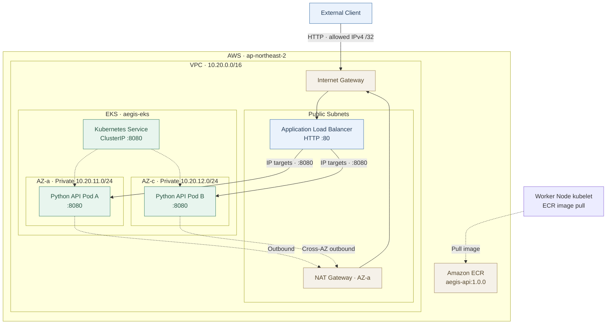

# AWS EKS 구축과 Pod 삭제 중 외부 응답 관측

Project Aegis의 기반 환경으로 Terraform을 사용해 AWS 서울 리전에 네트워크와 EKS를 구축하고, Private Subnet의 Python API를 ALB에 연결했다. 이후 실제 Pod를 삭제하면서 외부 HTTP 응답과 자동 복구 과정을 관측했다.

이번 실험에서는 **Terraform State, AWS 리소스 상태, Kubernetes 상태, 외부 HTTP 응답**을 각각 확인했다. 도구 하나에서 정상이라고 표시되는 것만으로 서비스 전체가 정상이라고 판단하지 않았다.

Pod 한 개를 삭제한 관측 구간에서 외부 순차 요청 **90건 모두 HTTP 200**을 반환했다. 삭제 요청 기록에서 새 Pod의 첫 외부 응답까지는 **약 7초**였다. 이는 정확한 Pod Ready 시간이나 노드 복구시간이 아니며, RTO나 무중단 보장을 검증한 결과도 아니다.

[아키텍처](#아키텍처) · [Pod 삭제 관측](#9-pod-장애-주입과-실제-응답) · [구축 중 EIP 복구 과정](#4-eip-조회-권한-오류와-부분-배포-복구)

## 1. 실험 당시 구축 상태

| 구성 | 실제 결과 |
| --- | --- |
| 리전 | `ap-northeast-2` |
| 네트워크 | VPC `10.20.0.0/16`, Public 2개·Private 2개 |
| 외부 경로 | IGW, 단일 NAT Gateway |
| EKS | `aegis-eks`, Kubernetes 1.36 |
| Worker Node | `m7i-flex.large` 2개, 서로 다른 AZ, Ready |
| 애플리케이션 | Python HTTP API 1.0.0, Deployment 2 Replicas |
| 이미지 저장 | ECR `aegis-api`, AMD64 이미지 |
| 외부 진입 | Internet-facing ALB, IP Target |
| Controller 인증 | IAM OIDC Provider + IRSA |
| 외부 API | `/healthz`, `/readyz`, `/api/info` HTTP 200 |
| 장애 실험 | Pod 1개 삭제, 외부 HTTP 90/90 성공 |
| Terraform 최종 검사 | `No changes` (종료 코드 0) |

[아키텍처 원본](diagrams/architecture.mmd) · [장애 복구 타임라인](evidence/recovery/recovery-timeline.svg)

아래 2~5장은 네트워크와 IAM을 구축하던 **당시의 문제와 복구 과정**을 보존한 기록이다. 이후 실제 배포 완료 결과는 6장부터 정리했다.

## 아키텍처



## 2. 네트워크 설계

서울 리전(`ap-northeast-2`)에서 두 AZ에 Public/Private 서브넷을 나눴다. 워커 노드는 Private 서브넷에 두고, 외부 서비스 접근은 NAT Gateway를 사용하도록 계획했다.

| 항목 | 구성 |
| --- | --- |
| VPC | `10.20.0.0/16`, DNS support/hostnames 활성화 |
| Public a / c | `10.20.1.0/24`, `10.20.2.0/24` |
| Private a / c | `10.20.11.0/24`, `10.20.12.0/24` |
| Public 기본 경로 | `0.0.0.0/0` → Internet Gateway |
| Private 기본 경로 | `0.0.0.0/0` → NAT Gateway |
| NAT Gateway | Public a에 1개, Elastic IP 1개 연결 |

두 AZ를 선택해 워커 노드 배치 범위를 확보했다. NAT는 실습 비용을 줄이기 위해 하나만 구성했다. 따라서 NAT가 있는 AZ에 장애가 나면 다른 AZ의 Private 서브넷도 외부 통신에 영향을 받을 수 있다. AZ를 가로지르는 NAT 통신에는 추가 데이터 전송 비용도 고려해야 한다. 이 구성을 고가용성 네트워크로 검증한 것은 아니다.

네트워크 15개는 VPC 1개, 서브넷 4개, IGW 1개, 라우팅 테이블 2개, 서브넷 연결 4개, EIP 1개, NAT Gateway 1개, Private 기본 경로 1개다. VPC 생성 시 AWS가 함께 만드는 기본 리소스까지 센 숫자는 아니다.

## 3. 실제 구축과 검증

AWS API 조회에서 다음을 확인했다.

- NAT Gateway 상태가 `available`이었다.
- Public/Private 서브넷이 각각 2개였고, `ap-northeast-2a`와 `ap-northeast-2c`에 구성됐다.
- Public 서브넷은 자동 공인 IP 할당이 켜져 있고, Private 서브넷은 꺼져 있었다.
- Public/Private 기본 경로가 각각 IGW/NAT를 가리켰고 `active`였다.
- 기존 EIP가 NAT에 연결됐다.

보존한 원본 증빙은 [NAT 조회 결과](evidence/network/nat-status.json)와 [네트워크 배포 후 No changes 결과](evidence/network/terraform-no-drift.txt)다. 두 파일은 네트워크 배포 당시의 기록이며 이후 IAM/EKS 코드까지 포함한 최신 실행 로그는 아니다. 원본에는 당시 리소스 ID가 남아 있지만 인증정보는 포함하지 않는다.

IAM 역할은 다음과 같이 구성하고 실제 연결 상태까지 조회했다.

| 역할 | 신뢰하는 서비스 | 연결 정책 |
| --- | --- | --- |
| `aegis-eks-cluster-role` | `eks.amazonaws.com` | `AmazonEKSClusterPolicy` |
| `aegis-eks-node-role` | `ec2.amazonaws.com` | `AmazonEKSWorkerNodePolicy`, `AmazonEC2ContainerRegistryPullOnly`, `AmazonEKS_CNI_Policy` |

CNI 정책은 초기 실습 구성을 단순하게 유지하려고 Node Role에 연결했다. 당시에는 워크로드별 최소 권한을 분리하는 구성을 적용하지 않았다.

## 4. EIP 조회 권한 오류와 부분 배포 복구

첫 네트워크 배포는 EIP를 할당한 뒤 `ec2:DescribeAddressesAttribute` 권한 오류로 중단됐다. `DescribeAddresses`와 별개의 API 권한이었다. VPC와 서브넷 등은 이미 생성됐기 때문에 전체 배포가 실패했다고 보고 처음부터 다시 실행하면 안 되는 상황이었다.

복구는 다음 순서로 진행했다.

1. 실패 메시지에서 부족한 API를 확인하고 기존 네트워크 정책에 해당 조회 권한을 추가했다.
2. `terraform state list`와 AWS EIP 조회를 대조했다. EIP가 State에 등록돼 있고 AWS에도 존재했다. 속성 조회 API는 종료 코드 0으로 바뀌었지만 `Addresses: []`를 반환해, 속성 데이터가 확인됐다고 기록하지 않았다.
3. 새 Plan에서 EIP가 `tainted`로 표시되고 `3 to add, 0 to change, 1 to destroy`가 나왔다. 이 계획은 적용하지 않았다.
4. State를 로컬 파일로 백업한 뒤 `terraform untaint aws_eip.nat`으로 교체 표시를 해제했다. 실제 EIP를 삭제하거나 State 내용을 직접 편집하지 않았다.
5. 새 복구 Plan에서 NAT Gateway와 Private 경로만 생성하는 `2 to add, 0 to change, 0 to destroy`를 확인했다.
6. 복구 계획을 적용해 `2 added, 0 changed, 0 destroyed`를 확인했다. 이후 NAT `available`, EIP 연결 및 `No changes`를 검증했다.

위 내용은 당시 구축 과정의 실행 결과를 정리한 것이다. 실패 당시 전체 터미널 로그를 별도의 원본 파일로 보관한 것은 아니므로, 재구성한 로그를 원본 증빙처럼 만들지는 않았다. State 백업과 이전 계획 파일은 로컬에 보존하고 Git에서 제외했다.

이번 실습에서 배운 점은 생성 실패 후에는 **오류 메시지, 실제 AWS 리소스, Terraform State와 새 Plan을 함께 확인해야 한다**는 것이다. `untaint`는 실패 이력만 보고 항상 적용하는 해결책이 아니다. 이번에는 실제 EIP 존재와 조회 권한 복구를 먼저 확인한 뒤 사용했다.

## 5. IAM 권한 구성에서 겪은 추가 이슈

Terraform 실행 사용자의 네트워크 권한과 EKS 관리 권한을 분리했다. 역할 관리 권한은 지정한 Cluster/Node Role 2개로 제한하고, 연결할 관리형 정책 4개와 `iam:PassRole`의 대상 서비스를 조건으로 지정했다. EKS 서비스 연결 역할 생성 권한도 별도로 정의했다.

역할 관리 정책을 사용자 인라인 정책으로 추가하려다 기존 인라인 정책과 합산한 2,048자 제한에 걸렸다. JSON 문법 오류는 아니었다. 기존 정책을 삭제하거나 관리자 권한으로 바꾸는 대신, 같은 JSON을 고객 관리형 `AegisEKSIAMRoleAccess` 정책으로 생성해 연결했다.

정책 시뮬레이터에서는 지정한 역할 ARN을 사용해 `CreateRole`, `AttachRolePolicy`, `DeleteRole`의 허용을 확인했다. 정책 연결 검사에는 `iam:PolicyARN` 조건도 입력했다. 이후 실제 역할 2개와 정책 연결 4개를 배포하고 AWS API로 조회했다. 당시에는 `PassRole`과 서비스 연결 역할을 이용한 실제 생성까지 검증하지 못했으나, 이후 Node Group 구축 과정에서 추가 권한 문제를 해결했다.

당시 구성한 EC2/EKS 관리 정책에는 서울 리전 조건이 있지만 일부 작업의 리소스 범위가 `*`다. 모든 권한이 리소스 단위 최소 권한으로 완성됐다고 설명하지 않는다. 사용자 정책은 콘솔에서 준비했으며 [iam.tf](terraform/iam.tf)가 관리하는 대상은 서비스 역할과 정책 연결이다.


## 6. EKS 구축 완료와 추가 장애

초기 Node Group 생성에서는 `iam:PassRole` 조건이 맞지 않아 실패했다. Node Role의 신뢰 대상은 `ec2.amazonaws.com`이지만, `CreateNodegroup` API로 역할을 전달받는 서비스는 `eks.amazonaws.com`이었다. 실행 사용자 정책에서 이 차이를 수정했다.

서비스 연결 역할의 조회 권한 문제도 추가로 해결했다. 이후 `t3.medium`이 해당 계정의 Free Tier 적격 유형이 아니라는 오류로 노드 생성이 실패했다. 제공 가능 유형과 계정 제약을 확인한 뒤 `m7i-flex.large`로 변경했고, 두 노드가 각각 AZ-a와 AZ-c에서 Ready 상태가 됐다.

CoreDNS, VPC CNI, kube-proxy를 확인하고 테스트 Pod에서 DNS 조회와 외부 HTTPS `HTTP 200`을 검증했다. 이 결과는 외부 접근 성공을 보여주지만 NAT 경유 패킷을 직접 캡처한 결과는 아니다.

## 7. Python API, ECR, Kubernetes Service

Python 표준 라이브러리로 세 경로를 구현했다.

| 경로 | 용도 |
| --- | --- |
| `/healthz` | HTTP 프로세스 생존 응답 |
| `/readyz` | 단순 요청 준비 응답 |
| `/api/info` | 서비스명, 버전, 응답 Pod 호스트명 |

로컬 ARM64 Docker 환경에서 API 응답을 검증하고, EKS 워커용 `linux/amd64` 이미지를 ECR에 업로드했다. Deployment는 2 Replicas, Pod 분산 제약, 비루트 실행, 리소스 제한 및 HTTP Probe를 사용했다.

서로 다른 AZ의 Pod 2개가 Ready였고 ClusterIP Service의 Endpoint에 두 Pod IP가 등록됐다. 클러스터 내부 Service에 30회 요청한 결과 각 Pod가 15회씩 응답했다. 이는 해당 테스트의 관측값이지 항상 50:50 분산된다는 보장은 아니다.

[내부 Service 응답 원본](evidence/app/load-balancing.txt)

## 8. ALB 외부 연결과 IAM 복구

EKS OIDC Provider를 등록하고 AWS Load Balancer Controller의 ServiceAccount에 전용 IAM Role을 연결했다. Helm으로 배포한 Controller v3.6.3은 2/2 Ready였다.

Controller IAM Policy와 Role 생성 과정에서 조회 권한 부족으로 Terraform이 부분 실패했다. AWS에는 두 리소스가 존재했지만 State에서는 `tainted`로 기록됐다. 조회 권한을 보완하고 실제 AWS 상태를 확인한 다음 State를 백업하고 `untaint`했다. 삭제·재생성 없이 Policy Attachment 1개만 적용해 복구했다.

Ingress는 Public Subnet 두 개에 internet-facing ALB를 구성했고, IP Target을 사용해 Private Pod에 직접 전달했다. HTTP 80 포트는 실습 당시 공인 IPv4 `/32`만 허용했다.

ALB 생성 직후 DNS 조회가 실패했지만 콘솔에서 `Provisioning` 상태임을 확인했다. 이후 DNS가 정상 해석되고 `/healthz`, `/readyz`, `/api/info` 모두 외부 HTTP 200을 반환했다.

ALB 경유 20회 요청에서 두 Pod가 각각 10회 응답했고, AWS Target Group에서 두 대상 모두 Healthy인 것을 확인했다.

[외부 HTTP 응답](evidence/alb/http-responses.txt) · [ALB 응답 20회](evidence/alb/alb-responses.txt) · [장애 전 Target 화면](evidence/alb/target-health.png)

## 9. Pod 장애 주입과 실제 응답

정상 상태에서 외부 요청 기록을 시작하고 Pod `h5h86`을 삭제했다. Deployment는 새 Pod `tnz25`를 생성했다. 새 Pod는 삭제된 Pod와 같은 Worker에서 실행됐다.

| 시각 (KST) | 관측 결과 |
| --- | --- |
| 00:42:00 | HTTP 모니터링 시작 |
| 00:42:05 | 기존 Pod 삭제 요청 |
| 00:42:07 | Deployment rollout 완료 출력 |
| 00:42:08~11 | 살아남은 Pod가 요청 처리 |
| 00:42:12 | 새 Pod가 외부 HTTP 요청에 최초 응답 |
| 00:43:37 | 90회 HTTP 기록 종료 |

| 응답 Pod | HTTP 200 횟수 |
| --- | ---: |
| 삭제한 Pod `h5h86` | 4 |
| 유지된 Pod `xzgcj` | 47 |
| 새 Pod `tnz25` | 39 |
| **합계** | **90** |

**90회 중 90회 HTTP 200(100%)**을 관측했다. 삭제 요청과 새 Pod 첫 응답의 시각 차이는 약 7초다. 이는 정확한 Pod Ready 시간이나 ALB Healthy 전환 시간과 같지 않다.

장애 후 AWS Target Group에서는 유지 Pod와 새 Pod가 Healthy였으며, 삭제된 Pod는 Draining 상태로 관측됐다. 삭제 후 등록 해제 과정이 진행되는 동안 두 정상 대상이 존재한다는 것을 확인했다.

[HTTP 90회 원본](evidence/recovery/http-during-failure.txt) · [타임라인](evidence/recovery/recovery-timeline.svg) · [Target 전환 화면](evidence/recovery/target-transition.png)

## 10. 한계, 비용, 운영 판단

- 워커 노드는 두 AZ에 분산됐지만 NAT는 한 AZ에만 있어 NAT/AZ 장애까지 견디는 구조는 아니다.
- ALB는 HTTP만 사용했다. 실제 서비스에는 HTTPS, 인증서와 추가 접근 통제가 필요하다.
- `/readyz`는 외부 의존성을 검사하지 않는 단순 정상 응답이다.
- VPC CNI 정책은 초기 실습 구성을 단순화하기 위해 Node Role에 연결했다.
- Pod 한 개 삭제만 검증했다. 노드 장애, AZ 장애, NAT 장애 및 고부하 상황까지 검증한 것은 아니다.
- 약 1초 간격의 90회 성공은 해당 실험의 관측 결과다. 모든 장애 상황에서 무중단을 보장하지 않는다.
- 비용은 EKS Control Plane, 실제 EC2 워커, EBS, NAT, IPv4, ALB, ECR 및 데이터 처리량에 따라 발생한다. 초기 `t3.medium` 가정 비용을 최종 실측 비용으로 사용하지 않는다.

Terraform은 VPC·EKS·IAM·ECR 등을 관리하고, ALB와 Target Group은 Kubernetes Controller가 관리한다. 따라서 Terraform `No changes`는 Controller 관리 리소스의 정상 상태까지 보장하지 않는다.

후속 [STEP 07](../07-safe-deployment/README.md)은 이 인프라 코드를 재사용해 환경을 재구축했고, 새 ALB에서 Blue/Green 슬롯 전환을 관측했다. [STEP 08](../08-observability-scaling/README.md)은 기존 ECR을 참조하는 별도 EKS·Terraform State 환경에서 자원과 확장 동작을 비교했다.

## 11. 코드 및 증빙

- `terraform/`: VPC, 네트워크, EKS, ECR, OIDC, IAM
- `app/`: Python API, Dockerfile
- `k8s/`: Deployment, Service, Ingress, Controller ServiceAccount
- `recovery-test.sh`: Pod 장애 주입과 HTTP 관측
- `diagrams/`: 아키텍처 원본
- `evidence/`: 네트워크·EKS·API·ALB·복구 원본 기록

로컬 AWS 프로필과 접속 IP, 계정별 ECR 주소, IAM Role ARN은 재현 환경에 맞게 준비해야 한다. State와 Plan 파일, 자격 증명은 Git 공개 대상에서 제외한다.


### 공개용 Kubernetes 설정

`k8s/`의 YAML에는 실제 AWS 계정번호와 개인 공인 IP 대신
`${AWS_ACCOUNT_ID}`, `${ALLOWED_CIDR}` 변수를 사용했다.

따라서 이 파일들은 환경변수를 치환하지 않은 상태로
`kubectl apply -f`를 실행하는 배포용 완성 파일이 아니다.

아래 예시는 AWS 계정 ID와 접속 CIDR만 치환한다. 재구축할 때는 Ingress에 고정된 당시 Subnet ID와 API 이미지 Digest를 환경에 맞게 확인하고, 해당 이미지가 실제 ECR에 존재하는지도 확인해야 한다. Controller의 Helm 설치와 환경별 Values 준비도 별도 수동 절차이므로, 이 예시만으로 전체 환경을 재구축할 수는 없다.

다음은 별도 패키지 설치 없이 로컬에서 렌더링하는 예시다.

```bash
export AWS_ACCOUNT_ID="본인 AWS 계정번호"
export ALLOWED_CIDR="본인 공인 IPv4/32"

python3 - <<'RENDER'
from pathlib import Path
from string import Template
import os

for name in [
    "api.yaml",
    "api-ingress.yaml",
    "alb-controller-serviceaccount.yaml",
]:
    src = Path("k8s") / name
    output = Path("/tmp") / name
    output.write_text(
        Template(src.read_text()).substitute(os.environ),
        encoding="utf-8"
    )
    print(output)
RENDER
```

이 명령은 `/tmp`에 치환된 파일을 생성할 뿐,
실제 Kubernetes 리소스에는 적용하지 않는다.
환경변수의 실제 값이나 렌더링 결과는 Git에 추가하지 않는다.

### 증빙 공개 범위

AWS Target Group 스크린샷 2장은 계정 식별 정보를 가린 공개용 이미지다.
원본 스크린샷은 로컬에 별도로 보관한다.

`evidence/recovery/terraform-final-check.txt` 역시
계정번호를 변수로 치환한 공개용 사본이다.
그 외 실험 측정값은 임의로 변경하지 않는다.

## 12. 회고

가장 어려웠던 부분은 매니페스트를 작성하는 작업보다 AWS 권한과 부분 배포 상태를 다루는 과정이었다. 생성 도중 권한 오류가 나더라도 실제 AWS 리소스가 이미 존재할 수 있었다.

이때 오류 메시지만 보거나 무조건 다시 적용하는 대신, **실제 AWS 상태 → Terraform State → 새 Plan**을 차례대로 확인하는 방식이 유효했다.

또한 Kubernetes의 Ready 상태만으로 외부 서비스가 정상이라고 판단하지 않았다. ALB DNS, 실제 HTTP 응답, Target Health까지 확인해야 비로소 요청 흐름을 설명할 수 있었다.

Pod 삭제 실험에서도 성공률 수치뿐 아니라 삭제된 Pod, 유지된 Pod, 새 Pod가 각각 언제 응답했는지 남긴 것이 가장 의미 있었다.
