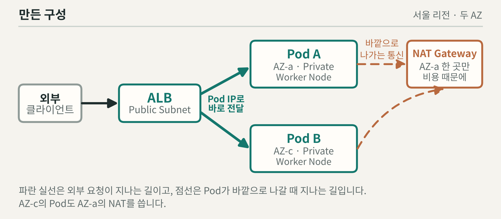
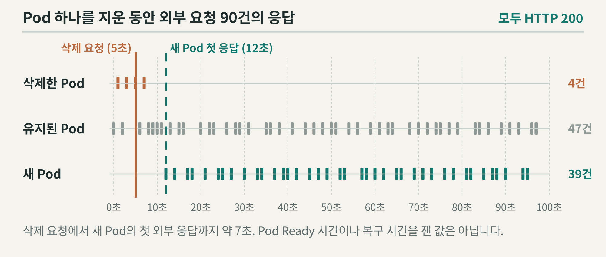
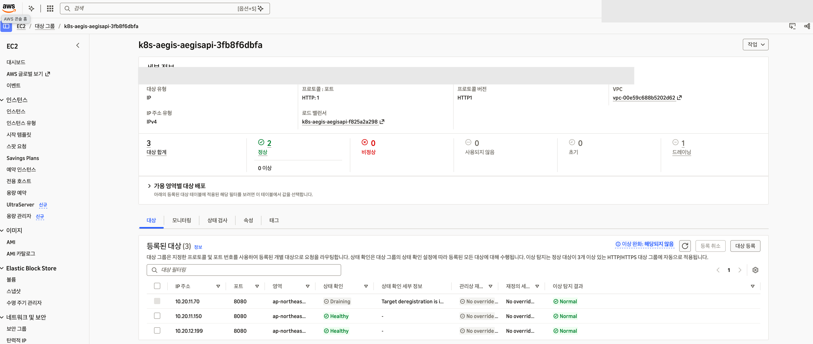
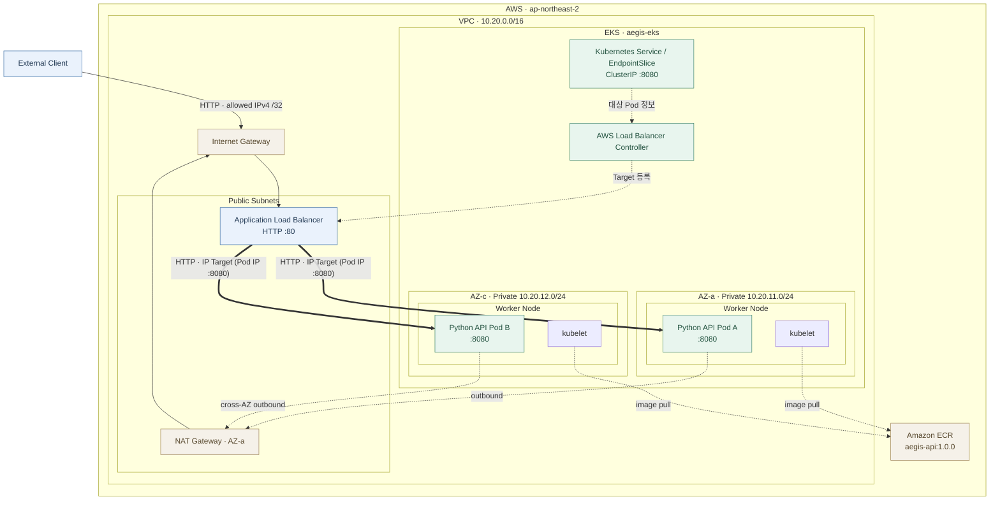

# Pod 하나를 지워도 외부 요청 90건은 모두 200이었다

<sub>Terraform · AWS EKS · ALB · Python API · 서울 리전(`ap-northeast-2`)</sub>

Terraform으로 서울 리전에 네트워크와 EKS를 만들고, Private Subnet에 둔 Python API를 ALB에 연결했습니다. 그 위에서 실제 Pod 하나를 지우고, 외부 HTTP 응답이 어떻게 나오는지 지켜봤습니다.

확인은 한 곳만 보지 않고 Terraform State, AWS 리소스, Kubernetes 상태, 외부 HTTP 응답을 각각 따로 했습니다. 한 도구에서 정상이라고 나와도 서비스 전체가 정상이라는 뜻은 아니었기 때문입니다.

구축 과정에서는 AWS 권한 오류로 Terraform 적용이 여러 차례 멈췄습니다. 일부 리소스가 이미 생성된 상태여서, AWS 실제 상태와 Terraform State를 대조한 뒤 다음 변경을 결정했습니다.

## 만든 구성



서울 리전의 두 AZ에 서브넷을 나누고, Worker Node 두 대를 서로 다른 AZ의 Private Subnet에 두었습니다. API는 Pod 2개이고, 인터넷에 열린 ALB가 Service를 거치지 않고 Pod IP로 바로 요청을 전달합니다.

실습 비용을 줄이려고 NAT Gateway는 한 AZ에만 두었습니다. 대신 다른 AZ의 Pod도 이 NAT를 쓰기 때문에, 그 AZ에 장애가 나면 영향을 받을 수 있고 AZ 간 데이터 전송 비용도 생길 수 있습니다.

## Pod 하나를 지웠을 때

정상 상태에서 ALB 주소로 약 1초 간격의 외부 요청 기록을 시작하고(00:42:00), 5초 뒤에 Pod `h5h86`을 삭제했습니다. Deployment가 새 Pod `tnz25`를 만들었고, 새 Pod는 삭제된 Pod와 같은 Worker에서 실행됐습니다.



| 응답한 Pod | HTTP 200 횟수 |
|---|---:|
| 삭제한 Pod `h5h86` | 4 |
| 유지된 Pod `xzgcj` | 47 |
| 새 Pod `tnz25` | 39 |
| 합계 | 90 |

90건 모두 HTTP 200이었습니다. 삭제 요청(00:42:05) 뒤에도 00:42:07까지는 삭제된 Pod가 응답했고, 00:42:08~11에는 유지된 Pod만 응답했습니다. 새 Pod가 처음 응답한 것은 00:42:12로, 삭제 요청에서 약 7초 뒤입니다. 이 7초는 Pod가 Ready가 된 시간이나 ALB에서 Healthy로 바뀐 시간과는 다른 값입니다.

삭제 후 확인한 Target Group 화면에는 Healthy 대상 2개와 Draining 대상 1개가 표시됐습니다.



성공률 숫자보다, 삭제된 Pod와 유지된 Pod와 새 Pod가 각각 언제 응답했는지 남긴 것이 이 실험에서 가장 쓸모 있었습니다.

## 구축 중 막힌 곳

권한 오류가 나도 AWS에는 리소스가 이미 만들어져 있을 때가 있었습니다. 그래서 다시 `apply`하기 전에 실제 AWS 상태와 State, 새 Plan을 먼저 맞춰 봤습니다. 막힌 곳은 네 군데였습니다.

### EIP 조회 권한

첫 네트워크 배포가 EIP를 만든 뒤 `ec2:DescribeAddressesAttribute` 권한이 없어서 멈췄습니다. VPC와 서브넷은 이미 만들어진 상태라 처음부터 다시 돌릴 수는 없었습니다.

권한을 추가하고 AWS와 State를 대조했더니 EIP는 양쪽에 있었습니다. 그런데 Terraform은 이 EIP를 `tainted`로 보고, 지우고 다시 만드는 `3 to add, 0 to change, 1 to destroy` 계획을 내놓았습니다. 이 계획은 적용하지 않았습니다.

대신 State를 백업하고 `terraform untaint aws_eip.nat`으로 교체 표시만 풀었습니다. Plan은 NAT Gateway와 Private 경로만 만드는 `2 to add, 0 to change, 0 to destroy`로 줄었고, 적용한 뒤 `No changes`까지 확인했습니다. 실제 EIP는 건드리지 않았습니다. `untaint`는 실제 EIP가 있고 권한이 복구된 것을 확인했기 때문에 쓸 수 있었던 방법입니다.

<details>
<summary>EIP 복구에서 확인한 것</summary>

- 속성 조회 API는 종료 코드 0이었지만 `Addresses: []`를 돌려줘서, 속성 데이터가 확인됐다고는 적지 않았습니다.
- 적용 결과는 `2 added, 0 changed, 0 destroyed`였고, 이후 NAT `available`과 EIP 연결, `No changes`를 확인했습니다.
- State를 직접 고치지 않았고, `DescribeAddresses`와 `DescribeAddressesAttribute`는 서로 다른 권한입니다.
- 실패 당시의 터미널 전체 로그는 원본으로 남기지 않았고, 재구성한 로그를 원본처럼 만들지도 않았습니다.

</details>

### 인라인 정책 2,048자 제한

Terraform을 실행하는 사용자의 권한을 네트워크용과 EKS 관리용으로 나누다가, 사용자 인라인 정책 합산 2,048자 제한에 걸렸습니다. JSON 오류가 아니었습니다. 기존 정책을 지우거나 관리자 권한으로 바꾸는 대신, 같은 내용을 고객 관리형 정책 `AegisEKSIAMRoleAccess`로 만들어 연결했습니다. 역할 관리 권한은 Cluster/Node Role 2개로 한정하고, 연결할 관리형 정책 4개와 `iam:PassRole`의 대상 서비스를 조건으로 지정했습니다. 정책 시뮬레이터에서는 지정한 역할 ARN으로 `CreateRole`, `AttachRolePolicy`, `DeleteRole`이 허용되는지 보았고, 정책 연결 검사에는 `iam:PolicyARN` 조건도 입력했습니다. 이후 역할 2개와 정책 연결 4개를 배포했습니다.

### Node Group의 PassRole과 인스턴스 유형

Node Group 생성은 `iam:PassRole` 조건 때문에 실패했습니다. Node Role이 신뢰하는 서비스는 `ec2.amazonaws.com`인데, `CreateNodegroup`으로 역할을 넘겨받는 서비스는 `eks.amazonaws.com`이었습니다. 허용 대상을 고치고 서비스 연결 역할의 조회 권한도 추가로 풀었습니다.

이어서 `t3.medium`이 이 계정의 Free Tier 대상 유형이 아니라는 오류로 노드 생성이 실패했습니다. 쓸 수 있는 유형을 확인해 `m7i-flex.large`로 바꿨고, 노드 두 대가 AZ-a와 AZ-c에서 Ready가 됐습니다.

### ALB Controller의 IAM

Load Balancer Controller의 IAM Policy와 Role을 만들다가도 조회 권한이 부족해서 일부만 만들어졌습니다. AWS에는 두 리소스가 있었지만 State에서는 `tainted`였습니다. 권한을 보완하고 AWS 상태를 확인한 뒤 State를 백업하고 `untaint`해서, 삭제나 재생성 없이 Policy Attachment 1개만 적용했습니다.

## 남은 한계

이 결과로 운영 환경의 무중단이나 고가용성을 말할 수는 없습니다.

NAT Gateway가 한 AZ에만 있어서, Worker를 두 AZ에 나눴어도 NAT나 그 AZ의 장애까지 견디는 구조는 검증하지 않았습니다. 장애 실험도 Pod 하나를 지운 것이 전부입니다. 노드, AZ, NAT 장애나 높은 부하는 시험하지 않았고, 약 1초 간격으로 90건이 성공했다는 것도 이 실험에서 관측한 값입니다.

ALB는 HTTP만 씁니다. 실제 서비스라면 HTTPS와 인증서, 접근 통제가 더 필요합니다. 권한도 최소 권한을 완성했다고 말하기 어렵습니다. EC2/EKS 관리 정책에 서울 리전 조건은 있지만 일부 작업의 리소스 범위는 `*`이고, VPC CNI 정책은 초기 구성을 단순하게 하려고 Node Role에 붙였습니다.

후속 기록인 [07 Blue/Green](../07-safe-deployment/README.md)은 이 인프라 코드를 재사용해 환경을 다시 만들고, 새 ALB에서 슬롯 전환을 관측했습니다. [08 CPU·HPA·OOM](../08-observability-scaling/README.md)은 기존 ECR을 참조하는 별도의 EKS·Terraform State 환경에서 자원과 확장 동작을 비교했습니다.

## 증빙

- Pod 삭제: [HTTP 90건 원본](evidence/recovery/http-during-failure.txt), [Target 화면](evidence/recovery/target-transition.png), [삭제](evidence/recovery/deletion-time.txt)·[rollout](evidence/recovery/rollout-time.txt) 시각, [Terraform 최종 검사](evidence/recovery/terraform-final-check.txt), 그 밖의 [장애 전후 상태](evidence/recovery/)
- ALB: [외부 HTTP 응답](evidence/alb/http-responses.txt), [ALB 응답 20회](evidence/alb/alb-responses.txt), [장애 전 Target 화면](evidence/alb/target-health.png)
- 앱·EKS·네트워크: [내부 Service 응답](evidence/app/load-balancing.txt), [`evidence/eks/`](evidence/eks/), [NAT 조회](evidence/network/nat-status.json), [배포 후 No changes](evidence/network/terraform-no-drift.txt)
- 코드: `terraform/`, `app/`, `k8s/`, [`recovery-test.sh`](recovery-test.sh)

네트워크 증빙 두 파일은 네트워크 배포 당시의 기록이라, 이후 IAM·EKS 코드까지 포함한 최신 실행 로그는 아닙니다. 리소스 ID는 남아 있지만 인증정보는 포함하지 않습니다.

<details>
<summary>구성 상세</summary>

### 자세한 아키텍처



굵은 실선이 실제 HTTP 요청 경로이고, 점선은 대상 등록·이미지 pull·outbound 같은 제어와 부가 경로입니다. ALB는 Service를 거치지 않고 Pod IP로 바로 전달하며, Service/EndpointSlice의 정보를 Controller가 읽어 ALB의 Target을 등록합니다. 다이어그램 원본은 [`architecture.mmd`](diagrams/architecture.mmd)입니다.

### 구성 표

| 구성 | 실제 결과 |
| --- | --- |
| 리전 | `ap-northeast-2` |
| 네트워크 | VPC `10.20.0.0/16`, Public 2개·Private 2개 |
| 외부 경로 | IGW, 단일 NAT Gateway |
| EKS | `aegis-eks`, Kubernetes 1.36 |
| Worker Node | `m7i-flex.large` 2개, 서로 다른 AZ, Ready |
| 애플리케이션 | Python HTTP API 1.0.0, Deployment 2 Replicas |
| 이미지 저장 | ECR `aegis-api`, AMD64 이미지 |
| 외부 진입 | Internet-facing ALB, IP Target |
| Controller 인증 | IAM OIDC Provider + IRSA |
| 외부 API | `/healthz`, `/readyz`, `/api/info` HTTP 200 |
| 장애 실험 | Pod 1개 삭제, 외부 HTTP 90/90 성공 |
| Terraform 최종 검사 | `No changes` (종료 코드 0) |

### 네트워크

| 항목 | 구성 |
| --- | --- |
| VPC | `10.20.0.0/16`, DNS support/hostnames 활성화 |
| Public a / c | `10.20.1.0/24`, `10.20.2.0/24` |
| Private a / c | `10.20.11.0/24`, `10.20.12.0/24` |
| Public 기본 경로 | `0.0.0.0/0` → Internet Gateway |
| Private 기본 경로 | `0.0.0.0/0` → NAT Gateway |
| NAT Gateway | Public a에 1개, Elastic IP 1개 연결 |

네트워크 리소스 15개는 VPC 1개, 서브넷 4개, IGW 1개, 라우팅 테이블 2개, 서브넷 연결 4개, EIP 1개, NAT Gateway 1개, Private 기본 경로 1개입니다. VPC를 만들 때 AWS가 함께 만드는 기본 리소스까지 센 숫자는 아닙니다.

### IAM 역할

| 역할 | 신뢰하는 서비스 | 연결 정책 |
| --- | --- | --- |
| `aegis-eks-cluster-role` | `eks.amazonaws.com` | `AmazonEKSClusterPolicy` |
| `aegis-eks-node-role` | `ec2.amazonaws.com` | `AmazonEKSWorkerNodePolicy`, `AmazonEC2ContainerRegistryPullOnly`, `AmazonEKS_CNI_Policy` |

사용자 정책은 콘솔에서 준비했고, [iam.tf](terraform/iam.tf)가 관리하는 대상은 서비스 역할과 정책 연결입니다.

### 그 밖에 알아 둘 것

- `/readyz`는 외부 의존성을 검사하지 않는 단순 정상 응답입니다.
- Terraform은 VPC·EKS·IAM·ECR 등을 관리하고, ALB와 Target Group은 Kubernetes Controller가 관리합니다. 그래서 Terraform의 `No changes`가 Controller가 만든 리소스의 정상 상태까지 보장하지는 않습니다.
- 비용은 EKS Control Plane, EC2 Worker, EBS, NAT, IPv4, ALB, ECR, 데이터 처리량에 따라 발생합니다. 처음 가정한 `t3.medium` 기준 비용은 최종 실측 비용으로 쓰지 않았고, 실제 청구 금액을 확인한 자료는 없습니다.

</details>

<details>
<summary>구축 후 검증</summary>

### 네트워크 검증

AWS API 조회에서 확인한 것은 다음과 같습니다.

- NAT Gateway 상태가 `available`이었습니다.
- Public/Private 서브넷이 각각 2개였고 `ap-northeast-2a`와 `ap-northeast-2c`에 있었습니다.
- Public 서브넷은 자동 공인 IP 할당이 켜져 있고 Private 서브넷은 꺼져 있었습니다.
- Public/Private 기본 경로가 각각 IGW/NAT를 가리켰고 `active`였습니다.
- 기존 EIP가 NAT에 연결돼 있었습니다.

### 클러스터와 앱

CoreDNS, VPC CNI, kube-proxy를 확인하고, 테스트 Pod에서 DNS 조회와 외부 HTTPS `HTTP 200`을 검증했습니다. 외부 접근이 된다는 것은 보여 주지만 NAT를 거친 패킷을 직접 캡처한 결과는 아닙니다.

Python 표준 라이브러리로 `/healthz`(프로세스 생존), `/readyz`(단순 준비 응답), `/api/info`(서비스명, 버전, 응답 Pod 호스트명)를 구현했습니다. 로컬 ARM64 Docker에서 응답을 확인하고, EKS Worker용 `linux/amd64` 이미지를 ECR에 올렸습니다. Deployment는 2 Replicas, Pod 분산 제약, 비루트 실행, 리소스 제한, HTTP Probe를 씁니다.

서로 다른 AZ의 Pod 2개가 Ready였고 ClusterIP Service의 Endpoint에 두 Pod IP가 등록됐습니다. 클러스터 내부 Service에 30회 요청했을 때 각 Pod가 15회씩 응답했습니다. 이 테스트의 관측값이고 늘 50:50으로 나뉜다는 보장은 아닙니다. ([원본](evidence/app/load-balancing.txt))

### ALB

EKS OIDC Provider를 등록하고 Load Balancer Controller의 ServiceAccount에 전용 IAM Role을 연결했습니다. Helm으로 배포한 Controller v3.6.3은 2/2 Ready였습니다. Ingress는 Public Subnet 두 곳에 internet-facing ALB를 만들고, IP Target으로 Private Pod에 직접 전달합니다. HTTP 80 포트는 실습 당시 공인 IPv4 `/32`만 허용했습니다.

ALB 생성 직후에는 DNS 조회가 실패했는데, 콘솔에서 `Provisioning` 상태인 것을 확인했습니다. 이후 DNS가 해석되고 `/healthz`, `/readyz`, `/api/info`가 모두 외부 HTTP 200을 돌려줬습니다. ALB를 거친 20회 요청은 두 Pod가 10회씩 응답했고, Target Group에서도 두 대상이 모두 Healthy였습니다.

</details>

<details>
<summary>재현과 공개 범위</summary>

로컬 AWS 프로필과 접속 IP, 계정별 ECR 주소, IAM Role ARN은 재현 환경에 맞게 준비해야 합니다. State와 Plan 파일, 자격 증명은 Git 공개 대상에서 제외했습니다.

### 공개용 Kubernetes 설정

`k8s/`의 YAML에는 실제 AWS 계정번호와 개인 공인 IP 대신 `${AWS_ACCOUNT_ID}`, `${ALLOWED_CIDR}` 변수를 썼습니다. 그래서 환경변수를 치환하지 않은 채 `kubectl apply -f`로 바로 배포할 수 있는 파일은 아닙니다.

아래 예시는 AWS 계정 ID와 접속 CIDR만 치환합니다. 다시 만들 때는 Ingress에 고정된 당시 Subnet ID와 API 이미지 Digest를 환경에 맞게 확인하고, 그 이미지가 실제 ECR에 있는지도 확인해야 합니다. Controller의 Helm 설치와 환경별 Values 준비도 별도의 수동 절차라서, 이 예시만으로 전체 환경을 다시 만들 수는 없습니다. 별도 패키지 설치 없이 로컬에서 렌더링하는 예시입니다.

```bash
export AWS_ACCOUNT_ID="본인 AWS 계정번호"
export ALLOWED_CIDR="본인 공인 IPv4/32"

python3 - <<'RENDER'
from pathlib import Path
from string import Template
import os

for name in [
    "api.yaml",
    "api-ingress.yaml",
    "alb-controller-serviceaccount.yaml",
]:
    src = Path("k8s") / name
    output = Path("/tmp") / name
    output.write_text(
        Template(src.read_text()).substitute(os.environ),
        encoding="utf-8"
    )
    print(output)
RENDER
```

이 명령은 `/tmp`에 치환된 파일을 만들 뿐 실제 Kubernetes 리소스에는 적용하지 않습니다. 환경변수 값이나 렌더링 결과는 Git에 추가하지 않습니다.

### 증빙 공개 범위

AWS Target Group 스크린샷 2장은 계정 식별 정보를 가린 공개용 이미지이고, 원본 스크린샷은 로컬에 따로 보관합니다. `evidence/recovery/terraform-final-check.txt`도 계정번호를 변수로 치환한 공개용 사본입니다. 그 밖의 실험 측정값은 임의로 바꾸지 않았습니다.

</details>
