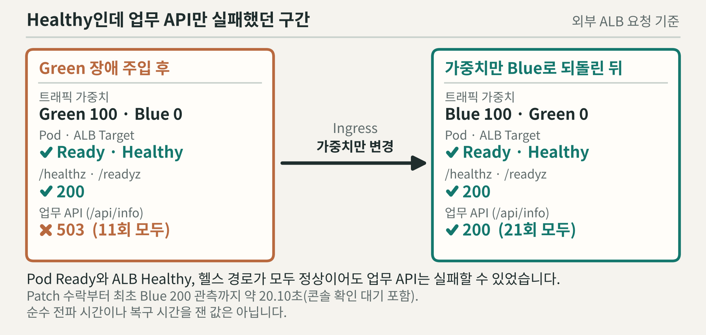

# Healthy인데 업무 API는 503이었다

GitHub Actions · ECR · EKS · ALB Weighted Forward · 2026-11-22

Blue/Green 중 Green으로 트래픽을 넘긴 뒤 업무 API에만 장애를 주입했습니다. `/healthz`와 `/readyz`는 200이고 ALB Target도 Healthy였지만 `/api/info`는 503이었습니다. 여기서 Ingress의 가중치를 수동으로 Blue에 되돌리고, 외부 업무 API가 다시 정상 응답하는 것까지 확인했습니다.

06에서 만든 Terraform 기반 EKS 구성을 다시 만들고, GitHub Actions가 ECR에 올린 이미지를 Blue와 Green 두 슬롯에 배치했습니다. 자동화는 CI와 OIDC 기반 ECR 게시까지이고, EKS 배포와 트래픽 전환, 복구는 제 Mac에서 수동으로 했습니다. 파이프라인 흐름은 [CI-CD.md](CI-CD.md)에 있습니다.

## 구성과 정상 전환

`GitHub Actions → OIDC → ECR → 수동 배포 → EKS Blue/Green → ALB Weighted Forward` 순서입니다. 06의 Terraform 코드로 VPC, NAT, EKS, 노드 2대를 다시 만들고 AWS Load Balancer Controller 3.6.3을 설치했습니다. Controller와 앱은 각각 Pod 2개입니다.

처음에는 Blue 100 / Green 0이었고 두 슬롯 모두 Target이 Healthy 2/2였습니다.

Ingress의 가중치 두 값만 바꿔 Green 100 / Blue 0으로 넘기고 다음을 확인했습니다.

- 설정: Kubernetes에 적은 값과 AWS 콘솔의 실제 Listener Rule을 따로 확인했습니다.
- 외부 요청: 업무 API가 [Blue](evidence/02-blue-green/normal-blue-http.json)와 [Green](evidence/02-blue-green/normal-green-http.json) 각각 21회(최초 1회 + 추가 20회) 모두 200이었습니다.
- 재실험 전 기준선: [Green 업무 API](evidence/02-blue-green/retry-green-baseline.json) 11회가 모두 Green 200이었습니다.

두 슬롯은 같은 이미지 Digest를 쓰고, 응답의 `version`은 환경변수로 `17ea0b4-blue`, `17ea0b4-green`을 줬습니다. 그래서 이 실험은 슬롯 전환이고, 서로 다른 앱 버전 사이의 Rollback은 아닙니다.

## 장애를 주입하고 되돌리기

Green Deployment의 `INJECT_API_FAILURE`를 0에서 1로 바꿨습니다. 헬스 경로는 그대로 200이라 Pod는 Ready, ALB는 Healthy를 유지했고 업무 요청만 실패했습니다. 외부 503을 확인한 직후 Ingress 가중치만 Blue로 되돌렸고, 정상 응답을 확인한 뒤 Green 환경변수를 원복했습니다. Blue Deployment와 이미지는 건드리지 않았습니다.

가장 먼저 볼 것은 세 가지입니다. Green의 헬스 경로는 200이었고, Green의 업무 API는 11회 모두 503이었고, Blue로 되돌린 뒤 업무 API는 21회 모두 200이었습니다.

| 관측 지점 | 결과 | 증빙 |
|---|---|---|
| 장애 Green의 Pod 2개 | `/healthz` 200, `/readyz` 200, `/api/info` 503 | [Pod별 응답](evidence/03-failure-rollback/fault-individual-pods.json) |
| Kubernetes | 현재 ReplicaSet의 활성 Pod 2개 Ready, EndpointSlice IP 일치 | [활성 Pod 관측](evidence/03-failure-rollback/fault-active-observations.json) |
| ALB | 새 Green IP 2개 Healthy, Green 100 / Blue 0 | [콘솔 관측 기록](evidence/03-failure-rollback/console-fault-observation.json) |
| 외부 요청 | Health·Readiness 200, 업무 API 11회 모두 503 | [외부 장애 응답](evidence/03-failure-rollback/fault-external.json) |
| 가중치 복귀 | Blue 100 / Green 0 실제 Rule 확인 | [콘솔 관측 기록](evidence/03-failure-rollback/console-rollback-observation.json) |
| 외부 복구 | 업무 API 21회(최초 1 + 추가 20) 모두 Blue 버전 200, 연결 오류 없음 | [복구 응답](evidence/03-failure-rollback/rollback-external.json) |
| Green 원복 | `INJECT_API_FAILURE=0`, Pod 업무 API 200, 원래 Deployment spec과 일치 | [원복 Pod 응답](evidence/04-recovery/restored-individual-pods.json) |
| 최종 상태 | 양쪽 Target Healthy 2/2, Blue 100 / Green 0, 외부 Blue 200 | [Target 콘솔 기록](evidence/04-recovery/console-restored-health-observation.json), [선별 리소스](evidence/04-recovery/final-resources-selected.json), [최종 HTTP](evidence/04-recovery/final-http.json) |

Patch 수락부터 최초 Blue 200 관측까지는 약 20.10초였습니다. 콘솔 확인을 기다린 시간이 들어 있어서, 연속 부하를 주고 잰 ALB 전파 시간이나 정확한 복구 시간은 아닙니다. 콘솔 확인 시각도 AWS 상태가 처음 바뀐 시각을 뜻하지 않습니다.

## 첫 시도에서 놓친 것

첫 시도는 Green RollingUpdate 직후 `len(pods)==2` 검사에서 멈췄습니다. 라벨로 조회하면 종료 중인 이전 Pod까지 잡혔기 때문입니다.

외부 503과 Target Health를 함께 확인하기 전이어서 완료로 기록하지 않았고, 안전 복구 로직으로 Blue 100과 Green 정상 설정을 복원했습니다. ([오류](evidence/03-failure-rollback/first-attempt-error.json), [타임라인](evidence/03-failure-rollback/first-attempt-timeline.json))

재실험에서는 종료 중인 Pod를 빼고 현재 ReplicaSet의 활성 Pod만 셌습니다.

- 현재 ReplicaSet은 Deployment revision과 OwnerReference UID로 찾고, `deletionTimestamp`가 없는 Pod만 셌습니다.
- 그 Pod의 Ready와 이미지 Digest, Deployment의 Replicas와 `observedGeneration`을 확인했습니다.
- 활성 Pod IP와 EndpointSlice IP를 대조했습니다.

안정화 대기는 최대 120초로 두고, 명백한 실패는 바로 중단하게 했습니다. 이 보완은 실행용 임시 스크립트에만 적용했고, 저장소의 앱·Manifest·CI/CD에는 들어가 있지 않습니다. 첫 시도에서 쓴 안전 복구 로직과 최종 실험의 수동 Rollback은 별개입니다.

## 남은 한계

Pod Ready, ALB Target Healthy, 실제 사용자 응답은 서로 다른 관측이었습니다. `/healthz`만 봤다면 이번 업무 API 장애는 놓쳤을 것입니다.

그래서 배포 뒤에는 업무 경로 Smoke Test가 필요하고, 복구도 설정을 바꾸는 데서 끝내지 않고 실제 응답까지 봐야 합니다.

이번 결과를 읽을 때 주의할 점은 다음과 같습니다.

| 구분 | 주의할 점 |
|---|---|
| 비교 대상 | 같은 이미지 Digest의 슬롯 전환입니다. 서로 다른 앱 버전 사이의 Rollback은 검증하지 않았습니다. |
| 부하 | 요청을 순차로 보냈습니다. 지속 부하, 동시 요청, 장기 안정성, 무중단은 확인하지 못했습니다. |
| 증빙 | ALB Target Health와 Rule은 관리자 콘솔에서 직접 본 관측 기록입니다. `describe-target-health` API 원본이나 화면 캡처가 아니고, CLI 조회 권한은 넓히지 않았습니다. |
| 자동화 | 자동화는 CI와 ECR 게시까지입니다. 독립된 배포 승인자 보호가 없고, CD와 Rollback은 수동입니다. |
| 다른 실험 | [05](../05-graceful-shutdown/README.md)의 SIGTERM·Drain 검증은 이번 앱에 적용하지 않았고, [02](../02-linux-oom-cgroup/README.md)의 OOM도 장애 원인으로 쓰지 않았습니다. [06](../06-aws-eks-infrastructure/README.md)의 인프라 코드를 다시 써서 새 ALB가 만들어졌습니다. |
| 리소스 | 실험과 증빙을 정리하던 2026-11-22에는 EKS, 노드, NAT, ALB가 실행 중이었습니다. 이후 삭제했다는 뜻이 아니고, 현재 리소스와 비용 정리 여부는 따로 확인해야 합니다. 당시 ECR 이미지와 GitHub 게시 인증은 남겨 두었습니다. |

## 증빙

원본 로그에서 대표 결과만 골라 마스킹한 JSON 사본이며, 선별 기준은 [증빙 안내](evidence/README.md)에 있습니다.

- CI·ECR 게시: [`evidence/01-ci-ecr/`](evidence/01-ci-ecr/)
- 정상 전환: [`evidence/02-blue-green/`](evidence/02-blue-green/)
- 장애·복귀: [`evidence/03-failure-rollback/`](evidence/03-failure-rollback/)
- 원복·최종 상태: [`evidence/04-recovery/`](evidence/04-recovery/)
- 설계와 재구축 메모: [DESIGN.md](DESIGN.md)

관측 타임라인 (2026-11-22)

[UTC/KST 타임라인 원본 사본](evidence/03-failure-rollback/timeline.json)과 대조한 시각입니다.

| 이벤트 | UTC | KST |
|---|---|---|
| Green 장애 Patch 수락 | 14:24:46.548 | 23:24:46.548 |
| Green rollout 완료 | 14:24:58.620 | 23:24:58.620 |
| 신규 Target Healthy 확인 게이트 통과 | 14:25:31.642 | 23:25:31.642 |
| 외부 업무 API 503 반복 확인 | 14:25:32.006 | 23:25:32.006 |
| Blue Rollback Patch 수락 | 14:25:32.919 | 23:25:32.919 |
| AWS Rule 반영 확인 게이트 통과 | 14:25:52.985 | 23:25:52.985 |
| 최초 외부 Blue 200 관측 | 14:25:53.016 | 23:25:53.016 |
| Green 원복 rollout 완료 | 14:26:06.716 | 23:26:06.716 |
| 최종 Blue 정상 확인 | 14:26:43.720 | 23:26:43.720 |

사용한 이미지 Digest

두 슬롯 모두 `aegis-api@sha256:a864b600e8bda071860db5b019b591be7bf45071fcc57c59c32c07fa1ea66ff2`를 썼습니다.

