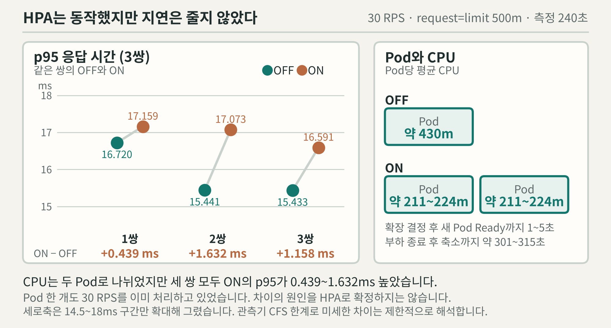

# HPA가 Pod를 1→2→1로 늘리고 줄였지만 응답은 빨라지지 않았다

EKS 1.36 · m7i.large Worker 2대 · CPU Limit 6회, HPA OFF/ON 각 3회, 독립 Job OOM 2회 · 2026-11-23–24 (KST)

CPU Limit, HPA, 메모리 Limit을 바꿔 가며 요청 처리가 어떻게 달라지는지 비교했습니다. 비교할 때마다 요청 수와 작업량은 똑같이 두고, 바꾸는 조건 하나만 달리했습니다.

HPA는 Pod를 1개에서 2개로 늘렸다가 다시 1개로 줄였고 CPU도 두 Pod로 나뉘었는데, 응답은 빨라지지 않았습니다. 세 쌍 모두 HPA를 켠 쪽의 p95가 0.439–1.632ms 더 높았습니다. 애초에 Pod 한 개로도 30 RPS를 처리하고 있었습니다. 측정 환경에도 놓친 부분이 있었는데, 아래 '관측기' 절에서 설명합니다.

## 핵심 결과

| 실험 | 관측한 결과 | 해석의 범위 |
| --- | --- | --- |
| CPU | 측정 16,204건 모두 HTTP 200 | 지연 차이는 쌍마다 달랐고, 처리량 개선은 입증하지 못함 |
| HPA | 측정 43,203건 모두 HTTP 200. 세 번 모두 1→2→1, Pod당 CPU 약 211–224m | 지연·처리량 개선 미입증. 조건부 PASS |
| OOM | 128Mi Job은 OOMKilled(exit 137), 256Mi는 Completed(exit 0) | 독립 Job의 종료 결과만 비교. 정확한 peak와 API의 OOM 복구는 미검증 |

성공 건수는 정해진 시간 동안 본 결과이고, 무중단이나 복구 시간을 보장하는 숫자는 아닙니다.

## 예상과 달랐던 부분

### CPU Limit: 차이가 일정하지 않았다

같은 15 RPS에서 250m과 1000m을 세 쌍 비교했습니다. CPU Limit을 걸면 CFS가 일정 주기마다 쓸 수 있는 CPU 시간을 제한합니다. 표의 '제한 기간 비율'은 그 제한에 걸린 주기의 비율입니다. 250m에서는 매번 제한이 걸렸지만, 지연 차이는 쌍마다 달랐습니다.

| 쌍 | 250m p95 (CFS 제한 기간 비율) | 1000m p95 (CFS 제한 기간 비율) | p95 차이 |
| --- | --- | --- | --- |
| 1 (T1·T2) | 39.028ms (1.392%) | 17.383ms (0%) | 21.644ms |
| 2 (T3·T4) | 31.934ms (51.358%) | 15.671ms (0%) | 16.263ms |
| 3 (T5·T6) | 15.874ms (50.098%) | 15.830ms (0%) | 0.045ms |

p95는 반올림한 값이라 차이와 0.001ms 어긋날 수 있습니다.

- 세 번째 쌍은 사실상 같았습니다. 250m의 T4와 T5는 제한 기간 비율이 비슷한데도 p95가 두 배 차이 났습니다. 이 비율만으로는 지연이 설명되지 않았고, 원인은 찾지 못했습니다.
- 20 RPS로 먼저 해 본 Pilot은 Probe 실패와 API 재시작이 생겨서, 과부하 사례로 따로 보관하고 6회 비교에서는 뺐습니다.
- T1·T2(11월 23일)와 T3–T6(11월 24일)은 약 9.09시간 떨어져 있어서, 이어진 실험으로 보지 않았습니다.

### HPA: 동작했지만 빨라지지는 않았다

부하는 30 RPS로 정했습니다. HPA를 끈 채 15–30 RPS를 짧게 먼저 해 봤는데, 25 RPS에서 CPU가 약 359m로 HPA 목표 350m(request 500m의 70%)에 가까웠습니다. 30 RPS(약 431m)까지 오류가 없어서 이 값으로 HPA를 켜고 해 보기로 했습니다.

결과는 이랬습니다.

- 세 번 모두 1→2→1로 동작했고, 확장 후 CPU는 Pod당 약 211–224m였습니다(OFF의 Pod 한 개는 약 430m).
- 지연은 줄지 않았습니다. 짝별 ON−OFF p95는 +0.439 / +1.632 / +1.158ms이고, 원인을 HPA로 확정하지는 않습니다.
- Pod 한 개도 30 RPS를 처리하고 있어서 처리량 개선도 확인할 수 없었습니다.

예상과 달랐던 점은 확장하는 순간에 지연이 잠깐 늘었다는 것입니다.

| ON 실행 | 확장 결정 → 새 Pod Ready | 확장 전환 중 요청 / p95 | Ready 전 Readiness 경고 | 부하 종료 후 축소까지 |
| --- | ---: | --- | ---: | ---: |
| 2 | 1초 | 30건 / 82.679ms | 1건 | 314.6초 |
| 3 | 5초 | 150건 / 166.161ms | 2건 | 301.3초 |
| 6 | 1초 | 30건 / 172.429ms | 1건 | 314.5초 |

표본이 작아서 일반적인 전환 지연이라고는 말하지 않습니다. 새 Pod가 Ready가 되기 전의 경고와 기존 Pod의 문제는 따로 봤고, 기존 Pod가 Ready를 잃거나 재시작한 기록은 없습니다.

실행 중에는 두 가지 일이 있었습니다.

- 첫 HPA Pilot은 새 Pod의 Readiness 경고 때문에 약 67초 만에 중단했습니다. 1→2→1 동작은 확인했지만 성능 비교는 하지 못했습니다.
- 본실험의 첫 OFF 실행 중에 k6 컨테이너 안에서 raw 파일을 `grep`/`wc`로 읽었는데, 그 때문에 CPU 작업이 늘었고 CFS counter가 오른 시점과 겹쳤습니다. 이게 원인이라고 확정하지는 못했습니다. 다만 측정 조건이 달라졌으니 이 실행은 참고용으로 따로 빼 두고, 같은 조건의 OFF를 다시 측정했습니다. 원본, 정상 결과(7,202건 모두 200, p95 15.728ms), 제외한 이유를 모두 남겼습니다.

### 관측기: 사전 기준을 실행 중에 적용하지 못했다

실험 전에 정한 중단·무효 기준 중에 '부하 생성기와 관측기에 CFS 제한이 계속 걸리는지'가 있었습니다([DESIGN.md](DESIGN.md) 4절). 그런데 실행 중에는 이걸 확인하지 못했습니다. 마지막에 Prometheus 데이터를 다시 보다가, node-exporter(CPU limit 50m)에 CFS 제한이 계속 걸려 있었다는 걸 알게 됐습니다.

| 실험 | 실행 수 | node-exporter CFS 기간 비율 (실행별 최댓값) |
| --- | ---: | --- |
| CPU | 6회 | 37.50–46.67% |
| HPA | 6회 | 41.94–47.06% |
| OOM | 2회 | 43.75%, 46.15% |

이 값은 2분 rate로 조회한 표본의 최댓값이고, API 컨테이너의 CFS와는 별개입니다. CPU 사용률이나 손실된 CPU 시간의 비율도 아닙니다. HPA 실행에서 node-exporter의 평균 CPU는 약 0.6–1m로 낮았지만, 제한이 걸렸다는 사실은 그대로 적어 둡니다.

그래서 HPA는 '조건부 PASS'로 적었습니다.

- 확인한 것: HPA의 1→2→1 동작, HTTP 200, CPU 분산. 근거는 node-exporter가 아니라 kubelet cAdvisor counter이고, target 11개는 수집 구간 내내 Up이었습니다(Up이 관측 정확도까지 보장하지는 않습니다).
- 통과하지 못한 것: 미리 정한 관측기 CFS 기준을 실행 중에 확인하지 못했습니다. 그래서 지연의 작은 차이는 조심해서 해석합니다.

결과를 본 뒤에 기준을 낮추지 않고 이 문제를 그대로 남겼습니다. 추가 실험이나 node-exporter 자원 변경도 하지 않았습니다.

### OOM: 종료 결과만 비교했다

128Mi Job은 OOMKilled/exit 137, 256Mi Job은 Completed/exit 0이었습니다. exit 137만 보지 않고 `state.terminated.reason`이 OOMKilled인 것을 확인했습니다.

메모리 최고값은 잡지 못했습니다.

- 128Mi의 마지막 할당 로그 112Mi는 실제 peak가 아닙니다.
- working_set 표본은 128Mi에서 약 3.88MiB 하나뿐이었고, 256Mi는 시계열이 없었습니다. Job이 scrape 간격(15초)보다 짧게 실행되어 놓쳤을 수 있습니다.
- 그래서 peak는 미확인으로 남기고, 종료 판정은 Kubernetes 종료 상태와 작업 로그로 했습니다. 시계열이 없는 것을 정상 사용의 증거로 보지 않았습니다.

같은 시간 API info 관찰 362건은 모두 200이었지만, Job 실행 중 요청은 128Mi에서 3건, 256Mi에서 14건뿐이라 API의 OOM 복구나 무중단의 근거로는 쓰지 않습니다.

## 남은 한계

- API 두 Pod가 같은 Worker에서 실행됐습니다. 노드 자동 확장이나 여러 노드에 걸친 고가용성은 확인하지 못했습니다.
- HPA 축소는 부하를 끈 뒤 관찰했습니다. 축소하는 중에 요청이 끊기지 않는지는 확인하지 못했습니다. Pod별 요청 수도 재지 않아서 두 Pod의 정확한 트래픽 비율은 모릅니다.
- OOM 비교는 각 조건 1회뿐이라 같은 결과가 반복되는지는 확인하지 못했습니다. API가 OOM에서 복구되는지도 보지 못했습니다.
- 실험 종료 당시 AWS 리소스를 보존했습니다. 실행 전 비용 추정은 [DESIGN.md](DESIGN.md)에 있지만 실제 청구액이 아닙니다.

## 증빙

- [CPU Limit 비교 — 6회 결과와 세션 분리·변동](evidence/cpu-limit-results-20261124.md)
- [HPA OFF/ON — 3쌍 결과, 전환 지연, 관측 품질과 제외 실행](evidence/hpa-results-20261124.md)
- [독립 Job OOM — 두 종료 결과와 메모리 관측 한계](evidence/oom-results-20261124.md)
- [HPA Pilot — 최초 중단과 1→2→1 확인 기록](evidence/hpa-pilot-results-20261124.md)
- [배포 검증 — 이미지·Pod·메트릭 연결 확인](evidence/deployment-verification-20261123.md)

원본 k6 raw/summary, Kubernetes 상태·Events·로그, Prometheus 쿼리와 SHA256 목록은 계정·네트워크·노드 식별자가 있어 Git 제외 경로에 따로 보관했습니다. 원본 범위와 공개 시 주의점은 [증빙 보관 기준](evidence/README.md)에 정리했습니다.

실험 환경과 비교 조건

서울 리전의 EKS 1.36과 m7i.large ON_DEMAND Worker 2대를 사용했습니다. 한 Worker에는 API를, 다른 Worker에는 k6와 Prometheus·Grafana·Metrics Server 등을 배치했습니다. HPA로 늘어난 API 두 Pod도 같은 API Worker에서 실행했습니다.

| 항목 | 실제 구성 |
| --- | --- |
| 네트워크 | VPC, public subnet 1개, private subnet 2개(2a/2c), NAT Gateway 1개 |
| API | Python 3.12 표준 라이브러리 HTTP 서버, 고정 횟수 정수 연산 |
| 관측 | kubelet cAdvisor의 CPU/CFS, Prometheus, kube-state-metrics, 별도 Metrics API |
| 통제 | 같은 측정용 이미지 digest, 같은 Node UID/providerID, API·발생기 역할별 배치 |
| 제외한 구성 | ALB·Ingress·별도 EC2 발생기·PVC 없음 |

| 비교 | 변경 변수 | 고정한 조건 |
| --- | --- | --- |
| CPU | limit 250m / 1000m | request 250m, replica 1, HPA OFF, W=100000, 15 RPS |
| HPA | OFF / ON | request=limit 500m, 시작 replica 1, W=100000, 30 RPS |
| OOM Job | memory limit 128Mi / 256Mi | request 64Mi, CPU 50m/100m, 192Mi 할당·페이지 쓰기, API info 관찰 1 RPS |

- API memory request/limit은 모든 비교에서 128/256Mi로 유지했습니다.
- HPA는 min 1/max 2, CPU 목표 70%(request 500m의 350m), 축소 안정화 300초였습니다.
- API 부하 비교는 HTTP/1.0 연결 종료와 k6 연결 재사용 금지를 같은 조건으로 적용했습니다.
- 구체적인 구간·표본·변경 변수는 각 결과 문서에 기록했습니다.

앞선 구축·배포 기록과의 관계, 종료 상태

- 06·07에서 쓴 EKS/API 구성을 참고하되, 이번 관측을 위한 별도 코드를 작성했습니다.
- 기존 `aegis-api` ECR은 Terraform data로 참조하고, 새 환경의 State는 `terraform/.state/terraform.tfstate`로 분리했습니다.
- 기존 State·ECR 이미지·GitHub OIDC/Publisher Role은 보존했습니다.
- 07의 Workflow가 이번 실험 이미지를 자동 빌드·배포한 구조는 아닙니다. 이 이미지는 별도로 게시해 digest로 고정했습니다.
- 실험 종료 후 API 1개 Ready, HPA OFF, Worker 2개 Ready, Prometheus 11/11 Up을 확인했습니다. 마지막 OOM 비교의 최종 상태 기록 시점에는 두 번째 k6 Job이 원본 수집 대기 구간이었고, k6 프로세스는 exit 0으로 끝났습니다.
- 실험 종료 당시 AWS 리소스는 보존했습니다. 예산 변수는 자동 과금 차단이나 삭제 타이머가 아닙니다.
- 구축 시의 [IAM 검토 기록](terraform/IAM-REVIEW.md)은 현재 실험 결과와 구분해 읽어야 합니다.

## 함께 보는 문서

- [DESIGN.md](DESIGN.md): 실험 전에 작성한 비교 프로토콜, 비용 추정, 삭제 순서, 노드 라벨 절차
- [REPRODUCE.md](REPRODUCE.md): 코드 구조, 로컬 검증, 실제 측정 절차, 재현의 한계
- [LOCAL-VALIDATION.md](LOCAL-VALIDATION.md): 로컬 검증 기록
